# PRD — Falette: Generator Wallpaper Algoritmik

Oct 5, 2026 · @FaL

## 1. Ringkasan

Falette adalah website gratis yang membuat wallpaper minimalis dengan algoritma, seluruhnya di browser tanpa backend. Pengguna memilih device, pola, dan warna, lalu melihat preview lock screen dengan jam dalam mode terang dan gelap. Hasilnya bisa diunduh sebagai PNG atau SVG, atau disalin sebagai kode SVG.

| Aspek | Keputusan |
| --- | --- |
| Halaman | Home dan Create |
| Backend | Tidak ada; semua dirender di perangkat pengguna |
| Stack dan hosting | SvelteKit (Svelte, Vite, TypeScript) dengan adapter-static, di-hosting sebagai situs statis di Vercel (Q2) |
| Biaya | Gratis, tanpa akun, iklan, atau fitur berbayar |
| Format unduhan | PNG, SVG, kode SVG |
| Fitur khas | Preview lock screen dengan jam, pasangan wallpaper terang/gelap, tema website terang/gelap, dan antarmuka English serta Indonesia (sembilan bahasa di Fase 2) |
| Referensi | [WLLPR](https://bypedroneres.github.io/wllpr-website/) |

## 2. Masalah dan peluang

Wallpaper minimalis yang pas untuk setiap device sulit didapat. Ukurannya sering tidak cocok, jarang tersedia berpasangan terang/gelap, dan sulit dibayangkan setelah tertutup jam lock screen.

Referensi [WLLPR](https://bypedroneres.github.io/wllpr-website/) sudah membuktikan konsep generator wallpaper minimalis. Namun [generator web-nya](https://wallpapergenerator.web.app/create/index.html) hanya menyediakan dua ukuran: Desktop 3840 × 2160 dan iPhone 1290 × 2796. Falette mengisi celah itu dengan banyak preset device, ukuran custom, format vektor, dan preview lock screen yang realistis.

## 3. Tujuan dan non-tujuan

Versi pertama berhasil bila pengguna bisa membuat dan mengunduh wallpaper yang pas untuk device-nya dalam satu menit, tanpa akun dan tanpa biaya operasional.

| ID | Tujuan | Ukuran keberhasilan |
| --- | --- | --- |
| G1 | Wallpaper pas untuk device pengguna, dengan cepat | Dari membuka Create sampai unduhan pertama ≤ 60 detik |
| G2 | Hasil tajam dan identik dengan preview | PNG berdimensi persis; SVG terbuka benar di Figma, Illustrator, dan Inkscape |
| G3 | Wallpaper bisa dinilai dalam kondisi nyata | Preview lock screen dengan jam, terang dan gelap, tersedia untuk setiap preset dan ukuran Custom |
| G4 | Biaya operasional nol | Tanpa server dan database; hosting statis tier gratis |

Di luar cakupan v1:

- Akun, login, galeri cloud, dan sinkronisasi antarperangkat.
- Unggah foto, AI image generation, dan wallpaper animasi.
- Aplikasi native desktop atau mobile (PWA dipertimbangkan di Fase 3).
- Iklan dan fitur berbayar.

## 4. Pengguna sasaran

Pengguna utama adalah orang yang ingin wallpaper rapi untuk ponsel atau laptop tanpa repot. Desainer dan developer menjadi pengguna sekunder yang butuh file vektor.

| Persona | Kebutuhan | Fitur kunci |
| --- | --- | --- |
| Pengguna umum | Wallpaper rapi dalam beberapa klik | Deteksi device, tombol Acak, unduh PNG, preview lock screen |
| Desainer | Aset vektor yang bisa diedit | Unduh SVG bersih, ukuran custom, palet kustom |
| Developer web | Background untuk situs atau aplikasi | Salin kode SVG atau data URI CSS |
| Pengguna multi-device | Set wallpaper serasi untuk ponsel, tablet, dan laptop | Seed yang sama untuk banyak preset, unduh ZIP |

## 5. Prinsip dan istilah

Lima prinsip ini menjadi penentu saat keputusan desain saling bertabrakan.

1. **Semua di browser.** Tidak ada data yang dikirim ke server dan tidak ada akun.
2. **Deterministik.** Konfigurasi dan seed yang sama selalu menghasilkan wallpaper yang sama.
3. **Preview sama dengan hasil.** File unduhan identik dengan preview, tanpa overlay jam.
4. **Ringan dan cepat.** Halaman cepat dimuat dan preview langsung merespons.
5. **Gratis tanpa syarat.** Tanpa akun, iklan, atau batas unduhan.

| Istilah | Arti |
| --- | --- |
| Pola | Algoritma pembentuk wallpaper, mis. Arcs atau Hills |
| Seed | Kata atau angka penentu hasil acak; seed sama, hasil sama. Di MVP seed berupa angka; kata yang mudah diingat menyusul di Fase 2 (PAT-05) |
| Palet | 1–5 warna yang dipakai pola. Palet 1 warna disebut monokrom, dan palet 2 warna disebut duotone |
| Preset | Ukuran dan tata letak lock screen untuk satu kelompok device |
| Mode wallpaper | Varian Terang atau Gelap dari satu desain |
| Tema website | Tampilan terang/gelap situs Falette sendiri, terpisah dari mode wallpaper |
| Overlay | Lapisan jam dan elemen lock screen di preview; tidak ikut diunduh |
| Zona aman | Area yang biasanya tertutup jam, widget, kamera, atau dock |
| P0, P1, P2 | Prioritas: P0 wajib di MVP, P1 masuk Fase 2, P2 masuk Fase 3 |
| Section Preview | Section di Home yang memamerkan engine lewat satu preview desktop; berbeda dari panel preview di Create |
| Latar | Warna dasar wallpaper, diatur terpisah dari palet: Otomatis (default) mengikuti rona warna pola pertama, atau Manual dengan rona pilihan pengguna; tingkat terangnya selalu mengikuti mode |

## 6. Struktur situs dan navbar

Falette punya dua halaman, Home dan Create, dengan navbar yang sama: Logo Falette, Create, Preview, Features, FAQ, dropdown bahasa, dan tombol tema terang/gelap.

| Rute | Halaman | Isi |
| --- | --- | --- |
| `/en/`, `/id/` | Home | Hero, Preview (`#preview`), Features (`#features`), FAQ (`#faq`), Footer |
| `/en/create/`, `/id/create/` | Create | Generator: panel kontrol, preview, aksi unduh |
| `/`, `/create/` | Pengalih | Mengarahkan ke bahasa tersimpan atau bahasa browser dengan hash tetap utuh (NAV-11) |
| `/404` | Tidak ditemukan | Pesan singkat dan tautan ke Home serta Create, dalam bahasa tersimpan dengan cadangan English |

Sejak MVP, setiap halaman punya versi per bahasa dengan awalan rute (NAV-11), misalnya `/en/` dan `/en/create/`.

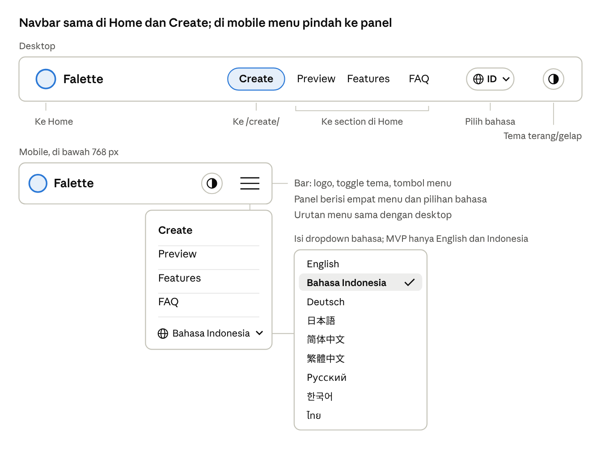

Create tampil sebagai tombol aksen sesuai usulan Q9; Preview, Features, dan FAQ selalu menuju section di Home.

| ID | Kebutuhan navbar | Prioritas |
| --- | --- | --- |
| NAV-01 | Logo Falette (ikon dan wordmark) di kiri, menuju Home, terbaca di kedua tema | P0 |
| NAV-02 | Menu berurutan Create, Preview, Features, FAQ. Semua tautan memakai awalan bahasa aktif: Create menuju `/id/create/` di tampilan Indonesia, dan tiga lainnya menuju section di Home seperti `/id/#preview`, juga saat diklik dari Create | P0 |
| NAV-03 | Toggle tema di ujung kanan dengan ikon matahari/bulan, selalu terlihat termasuk di mobile | P0 |
| NAV-04 | Navbar sticky; latarnya solid atau blur saat halaman di-scroll agar menu tetap terbaca | P0 |
| NAV-05 | Di bawah 768 px: Logo, toggle tema, dan tombol menu; menu membuka panel berisi Create, Preview, Features, FAQ, dan dropdown bahasa | P0 |
| NAV-06 | Aksesibel: elemen `<nav>`, bisa dipakai dengan keyboard, fokus terlihat, panel menu tertutup dengan Esc | P0 |
| NAV-07 | Status aktif: Create menyala di halaman Create (mis. `/id/create/`); di Home, menu section menyala sesuai section yang sedang terlihat | P1 |
| NAV-08 | Scroll halus ke section, dimatikan bila `prefers-reduced-motion` aktif | P1 |
| NAV-09 | Dropdown bahasa di kiri toggle tema, yang di MVP berisi English dan Bahasa Indonesia. Nama bahasa ditulis dalam bahasanya sendiri, dan dropdown bisa dipakai dengan keyboard (panah, Enter, Esc). Mengganti bahasa pindah ke halaman yang sama dalam bahasa lain dengan hash tetap utuh, sehingga desain di Create tidak hilang | P0 |
| NAV-10 | Tanpa pilihan tersimpan, bahasa mengikuti browser (mulai Fase 2, zh-CN dan zh-SG ke 简体中文, zh-TW dan zh-HK ke 繁體中文), dengan cadangan English. Pilihan disimpan di `localStorage`, mengubah atribut `lang` halaman, dan dipakai untuk nama hari serta bulan di preview jam | P0 |
| NAV-11 | Rute statis per bahasa dengan tag `hreflang`, agar setiap bahasa terindeks mesin pencari: `/en/` dan `/id/` di MVP, lalu `/de/`, `/ja/`, `/zh-hans/`, `/zh-hant/`, `/ru/`, `/ko/`, dan `/th/` bersama NAV-12. Rute `/` dan `/create/` mengarahkan ke bahasa tersimpan atau bahasa browser (NAV-10), dengan hash URL tetap utuh agar link berbagi membuka desain yang sama. Pengalihnya berupa skrip kecil (file sendiri, atau inline dengan hash CSP seperti THM-04) yang memakai `location.replace`; halaman pengalih memuat tautan English dan Indonesia di `noscript`, dan `/` ditandai `hreflang="x-default"` | P0 |
| NAV-12 | Tujuh bahasa tambahan di Fase 2, sehingga urutan lengkap dropdown menjadi English, Bahasa Indonesia, Deutsch, 日本語 (Jepang), 简体中文 (Mandarin Sederhana), 繁體中文 (Mandarin Tradisional), Русский (Rusia), 한국어 (Korea), dan ไทย (Thailand) | P1 |

## 7. Halaman Home

Home menjelaskan Falette dalam satu scroll dan mengarahkan pengunjung ke Create. Urutannya Hero, Preview, Features, FAQ, lalu Footer. Preview memperlihatkan engine bekerja langsung, sedangkan Create adalah alat lengkapnya.

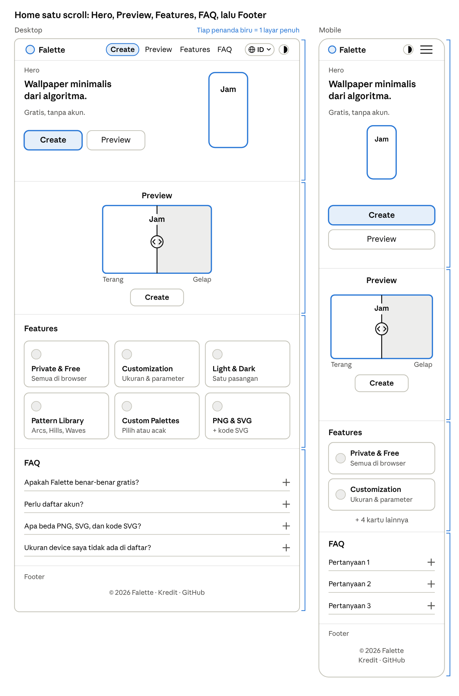

Di mobile, menu pindah ke tombol menu, kedua tombol CTA bertumpuk di bawah mockup, dan kartu Features menjadi satu kolom. Navbar dan hero bersama-sama mengisi tepat satu layar ponsel (HOME-03). Garis biru di kanan tiap frame menandai empat bagian yang masing-masing mengisi satu layar penuh (HOME-15).

| ID | Bagian | Kebutuhan | Prioritas |
| --- | --- | --- | --- |
| HOME-01 | Hero | Headline dan satu baris subjudul yang singkat, mis. "Wallpaper minimalis dari algoritma." dan "Gratis, tanpa akun." Tidak ada baris info tambahan | P0 |
| HOME-02 | Hero | Tombol utama "Create" ke Create dengan awalan bahasa aktif (mis. `/id/create/`) dan tombol kedua "Preview" ke `#preview` | P0 |
| HOME-03 | Hero | Di ponsel, navbar dan hero bersama-sama mengisi tepat satu layar penuh (tinggi 100svh agar tidak terpotong bilah browser). Judul, mockup, dan kedua tombol harus muat tanpa scroll; ukuran mockup menyesuaikan sisa tinggi layar | P0 |
| HOME-04 | Hero | Satu mockup device berisi wallpaper dari engine dengan jam berjalan, mengikuti tema website. Setiap 2 detik ukuran device (dari preset) dan polanya berganti acak dari set pola pamer Home (4–8 pola yang ikut dimuat bersama halaman) di dalam kotak berukuran tetap, sehingga tinggi hero tidak berubah. Pergantian berhenti selama mockup disentuh, diarahkan kursor, atau mendapat fokus keyboard, dan berlanjut saat kursor atau fokus pergi atau mockup diketuk lagi. Pergantian juga berhenti saat tab tidak aktif atau prefers-reduced-motion aktif | P0 |
| HOME-05 | Preview | Preview live dari engine, bukan video: pola dari set pola pamer Home berganti tiap ±3 detik, lengkap dengan overlay lock screen dan jam | P0 |
| HOME-06 | Preview | Satu preview layar desktop tanpa pilihan device (layar lebar paling jelas menunjukkan beda terang dan gelap), dengan slider pembanding yang membelah preview menjadi sisi terang dan gelap. Label Terang ada di kiri bawah dan Gelap di kanan bawah preview; slider bisa digeser dengan tombol panah dan memakai peran ARIA slider | P0 |
| HOME-07 | Preview | Tombol "Create" di bawah preview membawa pola, seed, palet, latar, dan parameter yang sedang tampil lewat URL; ukuran device tidak ikut dibawa, sehingga Create tetap mendeteksi device pengunjung (DEV-03); mode tampilan juga tidak dibawa, jadi Create memakai tampilan awalnya (MODE-03) | P0 |
| HOME-08 | Preview | Pergantian otomatis berhenti selama pengguna berinteraksi (sentuh, kursor, atau fokus keyboard pada preview) dan berlanjut saat kursor atau fokus pergi, atau saat preview diketuk lagi. Pergantian juga berhenti saat tab tidak aktif atau `prefers-reduced-motion` aktif | P0 |
| HOME-09 | Features | Enam kartu berisi ikon, judul, dan satu kalimat, berurutan: Private & Free, Customization, Light & Dark, Pattern Library, Custom Palettes, dan PNG & SVG | P0 |
| HOME-10 | Features | Grid 3 kolom di desktop, 2 di tablet, 1 di mobile | P0 |
| HOME-11 | FAQ | Accordion yang aksesibel (`<details>`/`<summary>` atau setara) dengan jawaban 2–4 kalimat; tiap pertanyaan tampil tanpa kotak, hanya dipisah garis bawah | P0 |
| HOME-12 | FAQ | Enam pertanyaan di bawah tabel ini | P0 |
| HOME-13 | Footer | Satu baris teks kecil yang redup, tetapi tetap memenuhi kontras minimal 4,5:1 (THM-06), berisi ©, tahun, nama Falette, kredit pembuat, dan tautan repositori atau sosial (opsional); tanpa logo atau menu tambahan | P0 |
| HOME-14 | Footer | Tautan kecil "Ikuti tema sistem" untuk mengembalikan tema website ke setelan sistem | P2 |
| HOME-15 | Tata letak | Home dibagi empat layar penuh: navbar + hero, Preview, Features, serta FAQ + footer. Navbar + hero mengisi satu layar (100svh); bagian lain setinggi minimal 100svh dikurangi tinggi navbar sticky dan memakai scroll-margin-top setinggi navbar, agar judulnya tidak tertutup saat dibuka lewat menu. Isi tiap bagian berada di tengah secara vertikal, dan boleh memanjang bila isinya lebih panjang, mis. saat jawaban FAQ terbuka | P0 |

Pertanyaan dan jawaban FAQ:

1. Apakah Falette benar-benar gratis? Jawaban: Ya, sepenuhnya gratis. Tidak ada iklan, langganan, fitur berbayar, atau batas unduhan. Semua wallpaper dibuat langsung di browser-mu, sehingga Falette tidak membutuhkan server berbayar.
2. Perlu daftar akun? Jawaban: Tidak. Buka halaman Create dan kamu bisa langsung membuat serta mengunduh wallpaper.
3. Apa beda PNG, SVG, dan kode SVG? Jawaban: PNG adalah gambar siap pakai dengan resolusi persis sesuai device, cocok langsung dijadikan wallpaper. SVG adalah file vektor yang tetap tajam di ukuran apa pun dan bisa diedit di Figma, Illustrator, atau Inkscape. Kode SVG adalah isi file SVG yang bisa langsung disalin ke situs atau aplikasimu.
4. Ukuran device saya tidak ada di daftar? Jawaban: Pilih Custom, lalu isi lebar dan tinggi layar dalam piksel, dari 320 sampai 7680 px per sisi. Komposisi wallpaper akan menyesuaikan rasio layarmu secara otomatis.
5. Bolehkah hasilnya dipakai untuk keperluan komersial? Jawaban: Tentu. Wallpaper yang kamu buat di Falette bebas dipakai untuk keperluan pribadi maupun komersial.
6. Bagaimana menyimpan wallpaper ke Foto di iPhone? Jawaban: PNG yang diunduh lewat Safari masuk ke app Files, di folder Unduhan. Buka file itu, ketuk tombol Bagikan, lalu pilih Simpan Gambar agar wallpaper masuk ke Foto.

## 8. Halaman Create

Create adalah generator lengkap: pengguna memilih device, pola, dan warna, lalu melihat hasil yang identik dengan file unduhan.

### 8.1 Tata letak

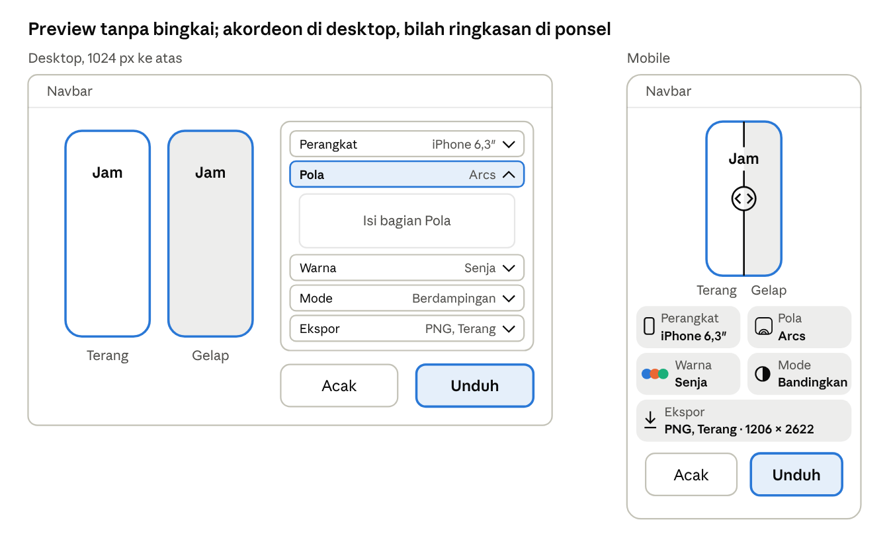

- Desktop (≥ 1024 px): preview besar di kiri tanpa bingkai; panel kontrol ±360 px di kanan berupa akordeon lima baris yang judulnya menampilkan pilihan aktif. Bagian Pola terbuka saat halaman pertama dibuka, dan membuka satu baris menutup baris lain. Tombol Acak dan Unduh menempel di bawah panel agar selalu terlihat.
- Mobile: preview di atas tanpa bingkai, lalu bilah ringkasan berupa lima kartu kecil. Tiap kartu menampilkan nama bagian, pilihan aktif, dan visual kecilnya: ikon perangkat, thumbnail pola, warna palet, ikon mode, dan format ekspor. Mengetuk kartu membuka lembar dari bawah berisi pengaturan bagian itu, tanpa menutup preview. Tombol Acak dan Unduh ada di bawah, dalam jangkauan jempol. Tablet (768–1023 px) memakai susunan yang sama.
- Di semua layar, bagian pengaturan berurutan sesuai alur kerja: Perangkat, Pola, Warna, Mode, Ekspor. Pilihan aktif tiap bagian selalu terlihat, hanya satu bagian yang terbuka pada satu waktu, dan Acak serta Unduh selalu terlihat. Ringkasan menampilkan nama palet terkurasi; palet acak atau yang diubah tampil sebagai Kustom, dan ukuran Custom tampil sebagai lebar × tinggi. Di Fase 2, undo/redo ada di samping Acak (PAT-06), ikon kunci ada di tiap slot warna untuk Acak palet (COL-04), dan favorit ada di bagian Ekspor (SHR-05). Di perangkat yang mendukung, tombol Unduh menjadi Simpan dan membuka menu Bagikan (EXP-08), sedangkan pilihan ZIP (EXP-09) dan salin sebagai CSS (EXP-10) masuk ke bagian Ekspor.

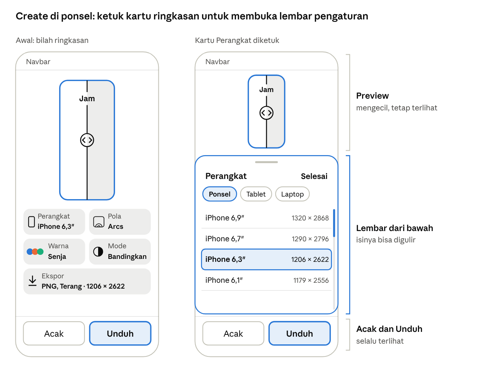

Di ponsel, mengetuk kartu di bilah ringkasan membuka lembar dari bawah. Preview mengecil tetapi tetap terlihat, isi lembar bisa digulir, dan tombol Acak dan Unduh tetap di tempat, sehingga hasil setiap perubahan langsung terlihat. Lembar ditutup dengan tombol Selesai atau digeser ke bawah. Saat keyboard terbuka, mis. untuk isian ukuran Custom atau HEX, baris Acak dan Unduh disembunyikan dan preview diperkecil sampai isian selesai.

### 8.2 Device dan ukuran

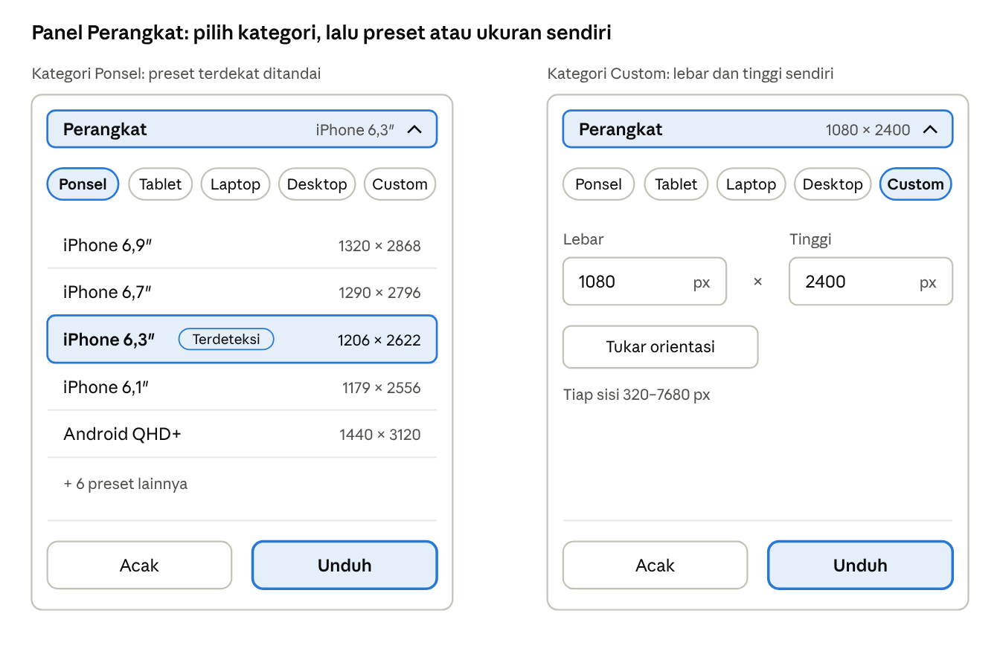

Panel dibuka di kategori hasil deteksi, dengan preset terdekat ditandai Terdeteksi dan daftar yang bisa digulir. Memilih Custom mengganti daftar preset dengan isian lebar dan tinggi, plus tombol tukar orientasi.

| ID | Kebutuhan | Prioritas |
| --- | --- | --- |
| DEV-01 | Kategori: Ponsel, Tablet, Laptop, Desktop, dan Custom | P0 |
| DEV-02 | Preset disimpan sebagai data JSON: ID, kategori, resolusi, contoh model, OS, templat overlay (PRV-03), dan tautan sumber spesifikasi (Lampiran A). Nama preset disimpan di file terjemahan dengan ID preset sebagai kunci, sedangkan contoh model tetap di JSON karena nama produk tidak diterjemahkan | P0 |
| DEV-03 | Bila URL dan pengaturan terakhir (SHR-04, mulai Fase 2) sama-sama tidak membawa ukuran device (d, atau w dan h), Create menebak device dari `screen` × `devicePixelRatio`, memilih preset terdekat, dan memberi label "Terdeteksi" dengan keterangan "perkiraan" di tooltip | P0 |
| DEV-04 | Ukuran custom 320–7680 px per sisi, dengan tombol tukar orientasi | P0 |
| DEV-05 | Komposisi menyesuaikan rasio layar, tidak direntangkan | P0 |
| DEV-06 | Orientasi potret/lanskap untuk preset tablet; ukuran Custom memakai tombol tukar orientasi di DEV-04 | P1 |
| DEV-07 | Opsi persegi untuk tablet (sisi = sisi terpanjang layar) agar wallpaper tetap penuh saat layar diputar | P1 |
| DEV-08 | Preset perangkat lipat, untuk layar luar dan layar dalam | P2 |

### 8.3 Pola

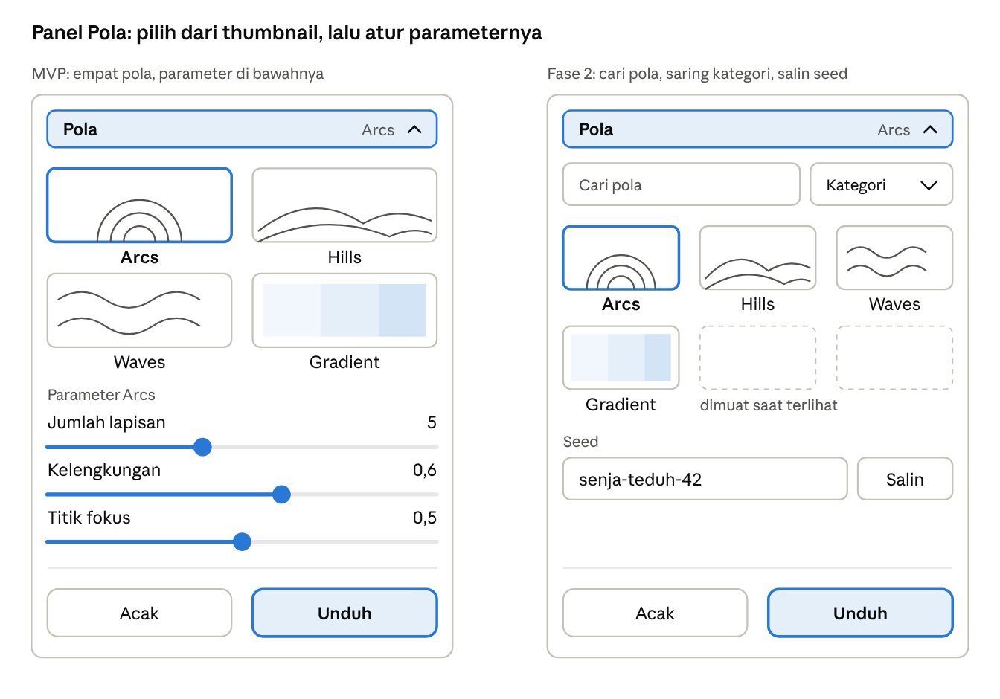

Di MVP, keempat pola tampil sebagai thumbnail, dan parameter pola yang dipilih ada tepat di bawahnya. Di Fase 2, panel ini mendapat pencarian, filter kategori, dan seed yang bisa disalin; thumbnail baru dirender saat terlihat di layar.

| ID | Kebutuhan | Prioritas |
| --- | --- | --- |
| PAT-01 | Minimal empat pola di MVP: Arcs, Hills, Waves, Gradient. Jumlahnya bertambah bertahap menjadi total 24 pola di Fase 2 dan 81 pola di Fase 3, menuju 100. Daftar lengkap pola beserta ID, fase, kategori, dan parameternya ada di file terpisah Katalog Pola (`docs/falette-100-pattern.md`), yang disimpan di repositori bersama PRD; sisa menuju 100 menunggu Q10 atau pola baru | P0 |
| PAT-02 | Tiap pola punya 2–4 parameter (mis. jumlah lapisan, kelengkungan, titik fokus); kontrolnya dibentuk otomatis dari skema parameter | P0 |
| PAT-03 | Pemilih pola menampilkan thumbnail yang dirender engine | P0 |
| PAT-04 | Tombol Acak hanya mengganti seed; pola, parameter, dan palet tetap. Pintasan keyboard R hanya aktif bila fokus tidak berada di isian teks, seperti pencarian pola, seed, HEX, atau ukuran Custom | P0 |
| PAT-05 | Seed tampil, bisa diedit dan disalin, berupa kata yang mudah diingat seperti `senja-teduh-42` | P1 |
| PAT-06 | Undo/redo hingga 20 langkah dalam satu sesi | P1 |
| PAT-08 | Pemilih pola tetap nyaman untuk 100 pola: ada kategori dan pencarian, dan thumbnail baru dirender saat terlihat di layar | P1 |
| PAT-09 | ID pola permanen dan tidak pernah dipakai ulang, karena tersimpan di link berbagi (kunci p di Lampiran B) | P0 |
| PAT-10 | Syarat rilis setiap pola: 2–4 parameter (PAT-02), seed berbeda menghasilkan variasi yang terlihat karena Acak hanya mengganti seed (PAT-04), tampil baik di semua rasio layar (diperiksa di 6 preset perwakilan, Lampiran A) serta di mode terang dan gelap, memenuhi batas render ENG-07, dan punya uji snapshot (ENG-08) | P0 |

### 8.4 Warna

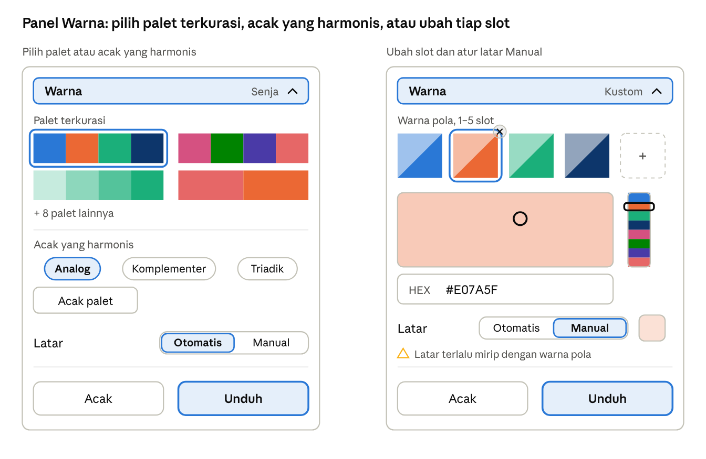

Panel dibuka dengan daftar palet terkurasi. Tombol Acak palet membuat palet harmonis menurut pilihan Analog, Komplementer, atau Triadik. Mengetuk satu slot membuka color picker dan isian HEX, dan slot bisa ditambah sampai lima atau dihapus sampai tersisa satu. Tiap slot terbelah dua: kiri atas versi terang, kanan bawah versi gelap. Latar diatur di baris tersendiri, Otomatis atau Manual (COL-05). Memilih Manual menampilkan kotak warna latar yang dibuka dengan color picker yang sama, dengan peringatan bila latar terlalu mirip dengan warna pola.

| ID | Kebutuhan | Prioritas |
| --- | --- | --- |
| COL-01 | Minimal 12 palet terkurasi, masing-masing dengan nama pendek yang ikut diterjemahkan: Senja, Fajar, Laut, Hutan, Pasir, Kabut, Malam, Kelopak, Kopi, Lumut, Batu, dan Teduh; beberapa di antaranya palet monokrom atau duotone. Palet terkurasi memakai Latar Otomatis, kecuali palet yang menyimpan latar khusus sebagai nilai Manual | P0 |
| COL-02 | Palet acak yang harmonis (analog, komplementer, triadik), dihitung di OKLCH; dipicu tombol Acak palet sesuai harmoni yang dipilih, dengan jumlah slot yang sedang dipakai tetap dipertahankan | P0 |
| COL-03 | Edit 1–5 slot warna pola lewat color picker dan input HEX; slot bisa dihapus sampai tersisa satu. Tiap slot tampil terbelah dua: versi terang dan versi gelapnya | P0 |
| COL-04 | Kunci warna tertentu saat mengacak palet | P1 |
| COL-05 | Latar diatur terpisah dari palet. Otomatis (default) memakai versi sangat terang dan pucat dari rona warna pola pertama di varian Terang, dan versi sangat gelapnya di varian Gelap. Manual menentukan rona dan kepekatan latar, sedangkan tingkat terangnya tetap dikunci per mode, terang untuk Terang dan gelap untuk Gelap; bila latar terlalu mirip dengan warna pola, panel menampilkan peringatan | P0 |

### 8.5 Mode wallpaper terang dan gelap

Setiap desain selalu punya dua varian dari seed yang sama; komposisinya identik, hanya warnanya yang berbeda.

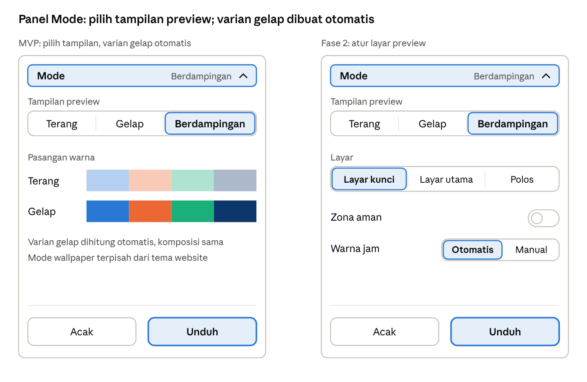

Di desktop, tampilan default adalah Berdampingan. Di mobile, pilihan ketiga menjadi Bandingkan, yang memakai slider pembanding dan menjadi tampilan awal (MODE-03). Di Fase 2, panel ini juga mengatur jenis layar, zona aman, dan warna jam (PRV-07 sampai PRV-09).

| ID | Kebutuhan | Prioritas |
| --- | --- | --- |
| MODE-01 | Varian Terang dan Gelap dihasilkan dari seed dan komposisi yang sama | P0 |
| MODE-02 | Varian gelap diturunkan di OKLCH: lightness dan chroma disesuaikan untuk latar dan warna pola, hue dipertahankan, bukan inversi RGB. Jarak lightness antara latar dan warna pola dijaga sama seperti di varian terang, dengan batas minimal agar pola tetap terlihat di kedua mode, dan chroma sedikit diturunkan agar warna tidak terlalu menyala | P0 |
| MODE-03 | Tampilan preview: Terang, Gelap, atau Berdampingan. Default desktop Berdampingan. Di mobile, Berdampingan diganti Bandingkan, yaitu slider pembanding seperti di section Preview di Home, dan Bandingkan menjadi tampilan awal | P0 |
| MODE-04 | Mode wallpaper diatur terpisah dari tema website | P0 |
| MODE-05 | Penyesuaian manual warna varian gelap per slot | P2 |

### 8.6 Preview lock screen dengan jam

Preview menampilkan wallpaper tanpa bingkai, dengan jam berjalan di atasnya, sehingga pengguna melihat hasilnya seperti di lock screen sendiri.

| ID | Kebutuhan | Prioritas |
| --- | --- | --- |
| PRV-01 | Overlay lock screen dibuat dengan HTML/CSS di atas wallpaper dan tidak ikut diunduh | P0 |
| PRV-02 | Elemen per kategori: ponsel dan tablet menampilkan status bar, tanggal, jam besar, dan indikator bawah; laptop dan desktop menampilkan jam dan tanggal sesuai pola OS. Ukuran Custom memakai tata letak kategori terdekat menurut rasionya: potret memanjang seperti ponsel, mendekati persegi seperti tablet, dan lanskap seperti desktop | P0 |
| PRV-03 | Posisi dan ukuran elemen diambil dari templat overlay per OS (iPhone, Android, iPad, Mac, desktop umum) dalam persen, bukan di-hardcode; tiap preset menunjuk satu templat (Lampiran A), dan ukuran Custom memakai templat kategori terdekat (PRV-02) | P0 |
| PRV-04 | Jam berjalan dan berganti tepat di pergantian menit; format 12/24 jam serta nama hari dan bulan mengikuti locale lewat `Intl.DateTimeFormat` | P0 |
| PRV-05 | Bingkai device generik dari CSS (sudut membulat, potongan kamera generik), tanpa logo atau aset resmi produsen; dipakai untuk mockup di Home dan unduhan mockup (EXP-12), sedangkan preview Create tampil tanpa bingkai | P0 |
| PRV-06 | Font jam berlisensi OFL (mis. Inter), bukan font sistem Apple atau Google; aksara Jepang, Mandarin, Korea, dan Thai memakai font bawaan perangkat sebagai cadangan | P0 |
| PRV-07 | Warna jam otomatis kontras dengan area di belakangnya, dan bisa diganti manual | P1 |
| PRV-08 | Mode tampilan: Layar kunci, Layar utama (grid ikon generik dan dock), atau Polos | P1 |
| PRV-09 | Overlay zona aman menandai area jam, widget, kamera, dan dock; engine menjauhkan elemen utama dari zona itu | P1 |
| PRV-10 | Peringatan keterbacaan bila kontras di area jam terlalu rendah | P2 |

### 8.7 Ekspor dan unduh

Semua file dibuat di browser dari string SVG yang sama dengan preview.

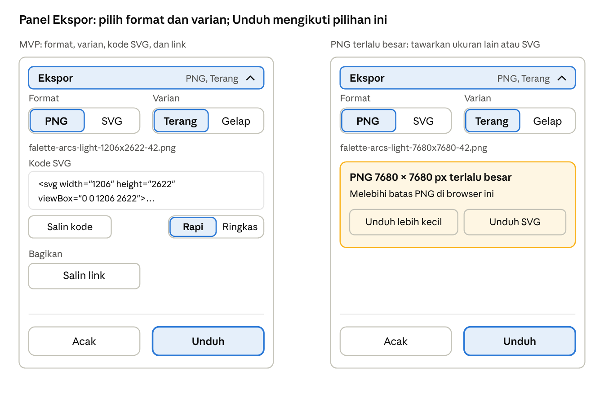

Tombol Unduh mengunduh format dan varian yang dipilih di panel ini. Defaultnya PNG, dengan varian mengikuti tampilan preview; saat Berdampingan atau Bandingkan, varian awalnya Terang. Tombol Salin link (SHR-02) ada di kelompok Bagikan dalam bagian Ekspor. Bila PNG melebihi batas browser, panel menawarkan ukuran lebih kecil atau SVG (EXP-06), dan selama file dibuat tombol Unduh menampilkan indikator proses (EXP-07).

| ID | Kebutuhan | Prioritas |
| --- | --- | --- |
| EXP-01 | PNG berdimensi persis sesuai preset atau ukuran custom (SVG → canvas → `toBlob`, atau `convertToBlob` di worker) | P0 |
| EXP-02 | SVG self-contained: tanpa font atau gambar eksternal, `width`/`height` dan `viewBox` sesuai ukuran, angka dibulatkan maksimal 2 desimal | P0 |
| EXP-03 | Panel kode SVG dengan tombol Salin serta pilihan Rapi atau Ringkas (minify); setelah menyalin, label tombol berganti menjadi Disalin (Copied) selama 2 detik, seperti Salin link (SHR-02) | P0 |
| EXP-04 | Unduh varian Terang atau Gelap secara terpisah | P0 |
| EXP-05 | Nama file `falette-{pola}-{mode}-{lebar}x{tinggi}-{seed}.{ext}` | P0 |
| EXP-06 | Batas PNG mengikuti kemampuan browser (Safari iOS sekitar 16,7 MP); bila terlampaui, tawarkan skala lebih kecil atau SVG | P0 |
| EXP-07 | Ekspor menampilkan indikator proses dan tidak membekukan UI; bila gagal, muncul pesan yang jelas beserta saran ukuran lebih kecil atau SVG. Setiap kali gagal, ukuran yang ditawarkan adalah setengah luas sebelumnya (sisi × 0,71); bila sisi terpendeknya akan di bawah 320 px, hanya SVG yang ditawarkan | P0 |
| EXP-08 | Tombol Simpan/Bagikan memakai Web Share API dengan file bila didukung, agar pengguna iPhone bisa menyimpan ke Foto; selain itu unduhan biasa | P1 |
| EXP-09 | ZIP berisi pasangan Terang dan Gelap, atau set beberapa preset dari seed yang sama | P1 |
| EXP-10 | Salin sebagai CSS background (data URI) | P1 |
| EXP-11 | Konfigurasi disisipkan di `<metadata>` SVG, sehingga desain bisa dibuka lagi lewat Impor SVG | P2 |
| EXP-12 | Unduh mockup (wallpaper, bingkai, dan jam) sebagai PNG untuk dibagikan | P2 |

Kotak PNG terlalu besar (EXP-06) dan kotak gagal ekspor (EXP-07) memakai bentuk dan tombol yang sama. Teksnya:

| Teks | Indonesia | English |
| --- | --- | --- |
| Judul, PNG terlalu besar | PNG {lebar} × {tinggi} px terlalu besar | PNG {width} × {height} px is too large |
| Isi, PNG terlalu besar | Melebihi batas PNG di browser ini | Exceeds this browser's PNG limit |
| Judul, gagal ekspor | PNG gagal dibuat | Couldn't create the PNG |
| Isi, gagal ekspor | Browser kehabisan memori atau menolak ukuran ini. Coba ukuran lebih kecil atau unduh SVG. | The browser ran out of memory or couldn't handle this size. Try a smaller size or download the SVG. |
| Tombol | Unduh lebih kecil · Unduh SVG | Download smaller · Download SVG |

### 8.8 Simpan dan bagikan tanpa backend

Tanpa database, URL dan penyimpanan browser menjadi tempat menyimpan desain.

| ID | Kebutuhan | Prioritas |
| --- | --- | --- |
| SHR-01 | Seluruh konfigurasi tersimpan di hash URL (`#…`) dan diperbarui dengan `replaceState`, tanpa menambah riwayat browser; hash tidak pernah terkirim ke server. Bila hash berubah saat Create terbuka, misalnya link lain ditempel di tab yang sama, desain dimuat ulang dari hash baru | P0 |
| SHR-02 | Tombol "Salin link"; membuka link menghasilkan desain yang identik. Setelah menyalin, label tombol berganti menjadi Disalin (Copied) selama 2 detik. Bila akses clipboard ditolak, link tampil di kotak teks baca-saja di bawah tombol, langsung terpilih, dengan label "Salin link ini secara manual:" (Copy this link manually:). Link yang disalin tidak memakai awalan bahasa (/create/#…), sehingga penerima membuka desain yang sama dalam bahasanya sendiri | P0 |
| SHR-03 | URL memuat versi engine (`v`). Perubahan algoritma yang mengubah hasil menaikkan versi; link lama tetap menghasilkan gambar yang sama atau menampilkan pemberitahuan | P0 |
| SHR-04 | Pengaturan terakhir diingat di `localStorage`. Urutan muat: konfigurasi di URL, lalu pengaturan terakhir, lalu deteksi device. Urutan ini berlaku per kunci: nilai yang ada di URL dipakai, nilai lain diambil dari pengaturan terakhir, dan deteksi device hanya mengisi ukuran yang masih kosong | P1 |
| SHR-05 | Favorit tersimpan di `localStorage` per perangkat, dengan thumbnail, dan bisa diekspor atau diimpor sebagai file JSON | P1 |

## 9. Tema website terang/gelap

Tema website mengikuti setelan sistem sampai pengguna menekan toggle; setelah itu pilihannya diingat di perangkat tersebut.

| ID | Kebutuhan | Prioritas |
| --- | --- | --- |
| THM-01 | Warna dikelola sebagai CSS custom properties; tema gelap menimpa token lewat `[data-theme="dark"]` | P0 |
| THM-02 | Tanpa pilihan tersimpan, tema mengikuti `prefers-color-scheme` dan ikut berubah bila setelan sistem berubah | P0 |
| THM-03 | Klik toggle mengganti tema dan menyimpan pilihan di `localStorage`, dibungkus try/catch | P0 |
| THM-04 | Skrip kecil inline di `<head>` menerapkan tema sebelum render pertama, sehingga halaman tidak berkedip; skrip ini diizinkan lewat hash di Content-Security-Policy | P0 |
| THM-05 | Toggle berlabel tetap "Mode gelap" dengan `aria-pressed`; ikonnya berganti matahari/bulan | P0 |
| THM-06 | Kontras teks dan komponen memenuhi WCAG AA di kedua tema | P0 |
| THM-07 | `color-scheme` dan `<meta name="theme-color">` mengikuti tema, termasuk kontrol form dan bar browser mobile | P1 |
| THM-08 | Transisi warna 150–200 ms, nonaktif bila `prefers-reduced-motion` aktif | P1 |

Arah visual: UI netral (abu-abu dengan satu warna aksen) agar warna wallpaper menjadi fokus, tipografi sans-serif berlisensi OFL, dan sudut membulat yang konsisten.

## 10. Mesin generator (engine)

Satu fungsi murni, `render(config)`, menghasilkan string SVG yang menjadi sumber tunggal untuk mockup hero, section Preview di Home, preview Create, dan semua ekspor.

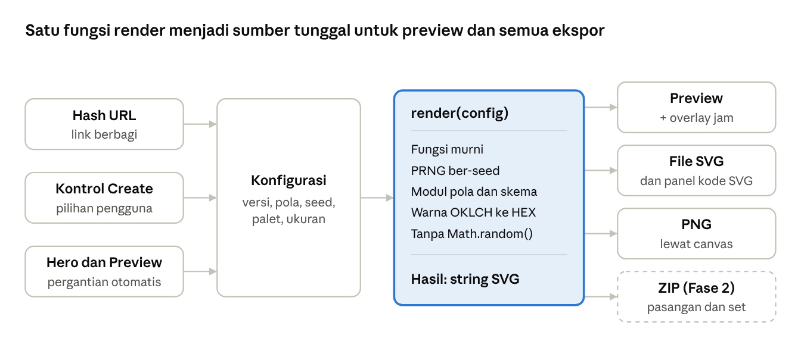

Overlay jam hanya ditempel di preview, sehingga file SVG, PNG, dan ZIP tetap berupa wallpaper murni.

| ID | Kebutuhan | Prioritas |
| --- | --- | --- |
| ENG-01 | `render(config)` adalah fungsi murni yang mengembalikan string SVG, dipakai bersama oleh mockup hero, section Preview di Home, preview Create, thumbnail pola, dan ekspor. SVG-nya hanya memakai atribut presentasi seperti `fill`, `stroke`, `opacity`, dan `stop-color`, tanpa atribut atau elemen `style`, agar lolos CSP ketat dan tampil sama di Figma, Illustrator, dan Inkscape | P0 |
| ENG-02 | Semua keacakan berasal dari PRNG ber-seed (mis. mulberry32, seed teks di-hash menjadi angka); `Math.random()` dilarang di engine | P0 |
| ENG-03 | Tiap pola berupa modul berisi `id`, nama, kategori, skema parameter, dan fungsi `generate()`; menambah pola tidak perlu mengubah UI | P0 |
| ENG-04 | Geometri memakai koordinat relatif terhadap ukuran kanvas dan menyesuaikan rasio potret, lanskap, atau ultrawide | P0 |
| ENG-05 | Warna dihitung di OKLCH, lalu ditulis sebagai HEX sRGB setelah penyesuaian gamut | P0 |
| ENG-06 | Tanpa filter SVG berat secara default; gradien memakai `linearGradient` dan `radialGradient` | P0 |
| ENG-07 | Render preview ≤ 50 ms di laptop kelas menengah dan ≤ 100 ms di ponsel kelas menengah; slider memicu maksimal satu render per frame | P0 |
| ENG-08 | Uji snapshot: sekumpulan seed tetap harus menghasilkan string SVG yang sama di setiap build | P0 |
| ENG-09 | Efek lapisan opsional di atas pola: grain/tekstur (juga mengurangi banding gradien di PNG), scanlines, dan light leaks, menunggu keputusan Q6; reeded glass mengikuti Q10 | P2 |
| ENG-10 | Daftar pola ringan (ID, nama, kategori) dimuat di awal untuk pencarian dan filter, sedangkan modul pola dimuat terpisah saat thumbnail-nya mulai terlihat atau saat dipilih (code splitting), sehingga JavaScript awal Create tetap ≤ 200 KB gzip berapa pun jumlah polanya | P1 |
| ENG-11 | Bila pola butuh lebih banyak warna daripada isi palet, engine mengisi kekurangannya dengan gradasi OKLCH dari warna yang ada: palet monokrom memakai tingkat terang berbeda dari satu warna, dan palet duotone memakai gradasi di antara kedua warnanya. Bila palet berisi lebih banyak warna daripada kebutuhan pola, pola memakai warna berurutan mulai dari slot pertama, dan slot yang tidak terpakai tampil redup di panel Warna | P0 |

## 11. Kebutuhan non-fungsional

Seluruh situs berupa file statis yang bisa di-host gratis, dengan target performa dan aksesibilitas yang terukur.

| Area | Kebutuhan |
| --- | --- |
| Arsitektur | 100% statis; tanpa server, database, atau API pihak ketiga yang wajib |
| Hosting | Vercel paket Hobby (gratis untuk proyek pribadi non-komersial) menyajikan hasil build SvelteKit adapter-static, dengan trailingSlash 'always' agar rute berakhiran garis miring seperti di tabel rute (Q2). Situs tetap bisa dipindah ke Cloudflare Pages, GitHub Pages, atau Netlify; subdomain gratis kecuali dipilih domain sendiri (Q7) |
| Performa | Lighthouse ≥ 90 di semua kategori; JavaScript awal ≤ 100 KB gzip di Home dan ≤ 200 KB gzip di Create; LCP < 2,5 detik di jaringan 4G; frame pertama mockup hero dan section Preview disisipkan sebagai SVG statis di HTML agar LCP tidak menunggu JavaScript; untuk mockup hero, versi Terang dan Gelap sama-sama disisipkan dan CSS menampilkan yang sesuai tema agar tidak berkedip. Home hanya memuat set pola pamer, bukan seluruh pustaka pola |
| Kompatibilitas | Dua versi mayor terakhir Chrome, Edge, Firefox, dan Safari; Safari iOS dan Chrome Android terbaru |
| Responsif | Lebar layar 360–2560 px tanpa scroll horizontal |
| Aksesibilitas | WCAG 2.2 AA; semua kontrol bisa dipakai dengan keyboard dan punya label; lembar dari bawah memindahkan fokus ke dalamnya saat dibuka, bisa ditutup dengan Esc atau digeser ke bawah, lalu mengembalikan fokus ke kartu asal; baris akordeon memakai aria-expanded; menghormati `prefers-reduced-motion` |
| Privasi | Tanpa akun, cookie, atau pelacak pihak ketiga; analitik, bila dipakai, harus tanpa cookie (Q3) |
| Keamanan | Content-Security-Policy ketat berbasis hash, tanpa `'unsafe-inline'`: SvelteKit (`kit.csp`, mode `hash`) menulis CSP sebagai meta tag di tiap halaman prerender dan meng-hash skrip bawaannya, sedangkan hash skrip tema (THM-04) dan pengalih bahasa (NAV-11) ditambahkan ke daftar `script-src`. Aturan yang tidak berlaku di meta tag, seperti `frame-ancestors`, dikirim sebagai header lewat `vercel.json`. Semua dependensi dibundel, tanpa skrip pihak ketiga saat runtime |
| Bahasa | English dan Bahasa Indonesia di MVP, sembilan bahasa di Fase 2 (NAV-09, NAV-12); semua teks UI ada di file terjemahan per bahasa, tanpa teks yang ditulis langsung di kode. Tata letak diuji di kesembilan bahasa karena teks Jerman dan Rusia lebih panjang dan pemenggalan baris aksara Thai berbeda. 日本語, 中文, 한국어, dan ไทย memakai font sistem agar halaman tetap ringan, dan hanya file terjemahan bahasa yang aktif yang dimuat. Nama menu dan section, judul kartu Features, serta tombol Create dan Preview tetap berbahasa Inggris di semua bahasa; teks lainnya, termasuk label kontrol Create, diterjemahkan (mis. Device menjadi Perangkat di tampilan Indonesia). Seed tetap dipakai sebagai istilah teknis, sedangkan Lock screen, Home screen, dan Minify menjadi Layar kunci, Layar utama, dan Ringkas |
| SEO dan berbagi | Title dan meta description per halaman, gambar Open Graph statis, sitemap |
| Offline | PWA dengan service worker agar bisa dipakai offline (Fase 3) |

## 12. Alur pengguna utama

Alur terpenting adalah pengguna ponsel yang ingin wallpaper siap pakai dalam kurang dari satu menit.

1. **Wallpaper ponsel cepat:** Home → tombol Create → halaman Create mendeteksi ponsel → pilih pola → Acak sampai cocok → cek preview terang dan gelap → Unduh PNG → di iPhone, Simpan ke Foto lewat menu Bagikan (Fase 2; di MVP file masuk ke Files).
2. **Aset untuk desainer:** Create → Custom 3000 × 2000 → atur palet → Unduh SVG → edit di Figma.
3. **Set multi-device (Fase 2):** Create → pilih desain → centang Ponsel dan Laptop → Unduh ZIP.
4. **Berbagi desain:** Create → Salin link → penerima membuka link → desainnya identik.
5. **Dari Preview:** Home → Preview → temukan desain yang disukai → Create → lanjut mengatur.

## 13. Rencana rilis

MVP memuat semua kebutuhan P0; P1 dan P2 menyusul dalam dua fase setelah rilis publik.

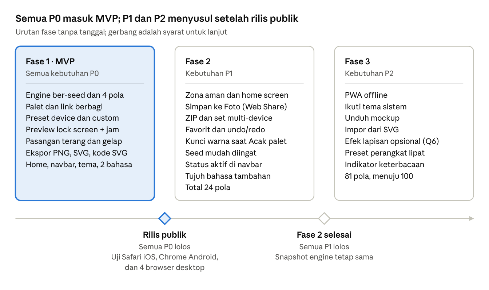

Rilis publik menunggu semua P0 lolos uji di Safari iOS, Chrome Android, dan empat browser desktop. Fase 2 selesai bila semua P1 lolos tanpa mengubah hasil uji snapshot engine. Fase 1 bisa dipecah menjadi 1a (engine dan ekspor) lalu 1b (preview dan Home), agar engine teruji lebih dulu. Jumlah pola bertambah bertahap: total 4 di MVP, 24 di Fase 2, dan 81 di Fase 3, menuju 100, dengan syarat rilis yang sama untuk tiap pola (PAT-10).

## 14. Metrik keberhasilan

Kualitas teknis diukur sejak MVP; metrik perilaku hanya bisa diukur bila analitik tanpa cookie disetujui (Q3).

| Metrik | Target | Cara ukur |
| --- | --- | --- |
| PNG berdimensi tepat | 100% preset | Uji otomatis per preset |
| SVG valid | Lolos validator; terbuka benar di Figma, Illustrator, Inkscape | Uji manual tiap rilis |
| Determinisme | 0 perbedaan pada seed uji | Uji snapshot (ENG-08) |
| Skor Lighthouse | ≥ 90 di semua kategori | Lighthouse di Home dan Create |
| Waktu ke unduhan pertama | Median ≤ 60 detik | Uji pengguna dengan 5 orang, atau analitik bila ada |
| Konversi Home ke Create | Baseline 30 hari setelah analitik dipasang (Q3) | Analitik tanpa cookie |
| Sesi Create yang berakhir dengan unduhan | Baseline 30 hari setelah analitik dipasang (Q3) | Event analitik tanpa cookie |

## 15. Risiko dan mitigasi

Risiko terbesar ada di ekspor PNG pada iPhone dan konsistensi hasil saat algoritma berubah.

| Risiko | Dampak | Mitigasi |
| --- | --- | --- |
| Batas ukuran canvas di Safari iOS | Ekspor PNG besar gagal | Deteksi batas; kecilkan skala atau arahkan ke SVG (EXP-06) |
| PNG di iPhone masuk ke Files, bukan Foto | Pengguna bingung mencari file | Web Share API (EXP-08) dan penjelasan di FAQ |
| Algoritma berubah, link lama menghasilkan gambar berbeda | Kepercayaan pengguna turun | Versi engine di URL dan uji snapshot (SHR-03, ENG-08) |
| Deteksi device meleset karena scaling OS atau setelan resolusi Android | Ukuran kurang pas | Label "perkiraan", cocokkan ke preset terdekat menurut rasio, pilihan manual selalu tersedia |
| Mockup menyerupai produk bermerek | Masalah merek dan lisensi | Bingkai generik, font OFL, tanpa aset resmi (PRV-05, PRV-06) |
| Banding pada gradien PNG | Wallpaper tampak bergaris | Hindari gradien lebar dengan selisih warna kecil; grain opsional (ENG-09). Chromium sudah memberi dithering; Safari dan Firefox diuji dulu lewat halaman uji ekspor, lalu dithering PNG diputuskan (Q11) |
| Slider lambat di ponsel lama | Pengalaman terasa berat | Maksimal satu render per frame; kompleksitas pola dibatasi |
| Kebijakan hosting gratis berubah atau kuotanya habis, mis. batas transfer data paket Hobby Vercel | Situs tidak tersedia | Situs statis portabel, bisa dipindah ke Cloudflare Pages, GitHub Pages, atau Netlify dengan cepat |
| Terjemahan sembilan bahasa | Teks salah atau tidak konsisten, rilis tertunda | Satu file sumber teks, penerjemah penutur asli, dan pemeriksaan tata letak per bahasa sebelum rilis |
| Pustaka bertambah hingga 100 pola | Beban uji naik tajam karena tiap pola harus dicek di 28 preset dan dua mode; pola yang kurang rapi bisa lolos ke rilis | Syarat rilis per pola (PAT-10), uji snapshot (ENG-08), pemeriksaan visual di 6 preset perwakilan (Q8), dan uji otomatis di semua preset |

## 16. Pertanyaan terbuka

Keputusan yang dibutuhkan sebelum Fase 1 sudah lengkap: Q2 (stack) dan Q8 (preset) sudah diputuskan, sedangkan Q3, Q6, Q7, Q10, dan Q11 bisa menyusul. Kolom Usulan berisi rekomendasi awal, atau keputusan bila statusnya Diputuskan.

| ID | Pertanyaan | Usulan | Status |
| --- | --- | --- | --- |
| Q1 | Preview berupa section di Home atau halaman sendiri? | Section `#preview` di Home, seperti di PRD ini | Diputuskan |
| Q2 | Stack teknologi? | SvelteKit (Svelte, Vite, TypeScript) dengan adapter-static: semua halaman di-prerender menjadi file statis, lalu di-hosting di Vercel paket Hobby. Next.js tidak dipilih karena runtime-nya saja sekitar 100 KB gzip, dan tanpa server butuh 'unsafe-inline' di CSP | Diputuskan |
| Q3 | Pakai analitik? | Tidak di MVP; bila perlu, analitik tanpa cookie | Terbuka |
| Q4 | Lisensi hasil wallpaper dan kode? | Wallpaper CC0 (bebas dipakai, termasuk komersial); kode MIT bila dibuka sebagai open source | Diputuskan |
| Q5 | Bahasa situs? | English dan Indonesia di MVP, tujuh bahasa lain di Fase 2 (NAV-09, NAV-12), dengan cadangan English | Diputuskan |
| Q6 | Pakai efek lapisan (grain, scanlines, light leaks)? | Tidak di MVP; di Fase 3 menjadi lapisan opsional yang ikut tersimpan di link (kunci fx di Lampiran B) | Terbuka |
| Q7 | Domain? | Subdomain gratis dari hosting dulu | Terbuka |
| Q8 | Daftar preset final? | 28 preset: 26 di Lampiran A ditambah tablet Android 16:10 dan laptop 16:10. Overlay jam memakai 5 templat menurut OS, pemeriksaan visual pola memakai 6 preset perwakilan, dan preset baru hanya dibuat untuk resolusi baru (Lampiran A) | Diputuskan |
| Q9 | Create bergaya tombol aksen di navbar? | Ya, sebagai ajakan utama | Diputuskan |
| Q10 | 16 pola Piksel dan Glyph di Katalog Pola dirilis khusus PNG, ditunda, atau dibuang? | Tunda sampai setelah Fase 3. Pola Glyph tetap bisa SVG bila hurufnya disimpan sebagai path; pola Piksel butuh jalur render canvas tersendiri karena engine dan ekspor PNG berbasis SVG (ENG-01, EXP-01) | Terbuka |
| Q11 | Beri dithering pada PNG gradien? | Belum di MVP. Chromium sudah memberi dithering sendiri; putuskan setelah uji Safari dan Firefox di halaman uji ekspor (laporan ekspor di repositori) | Terbuka |

## Lampiran A. Preset device awal

Preset awal mencakup 28 ukuran dalam empat kategori; resolusi model diambil dari halaman spesifikasi yang tertaut, data per Oct 5, 2026. Ponsel dan tablet ditulis potret (lebar × tinggi), laptop dan desktop lanskap.

| ID | Kategori | Preset | Contoh model | Resolusi (px) |
| --- | --- | --- | --- | --- |
| `ios-69` | Ponsel | iPhone 6,9″ | [iPhone 18 Pro Max](https://www.apple.com/iphone-18-pro/specs/), [iPhone 17 Pro Max](https://useyourloaf.com/blog/iphone-17-screen-sizes/), [iPhone 16 Pro Max](https://useyourloaf.com/blog/iphone-17-screen-sizes/) | 1320 × 2868 |
| `ios-67` | Ponsel | iPhone 6,7″ | [iPhone 16 Plus](https://useyourloaf.com/blog/iphone-17-screen-sizes/), [iPhone 15 Pro Max](https://useyourloaf.com/blog/iphone-17-screen-sizes/), [iPhone 15 Plus](https://useyourloaf.com/blog/iphone-17-screen-sizes/), [iPhone 14 Pro Max](https://useyourloaf.com/blog/iphone-17-screen-sizes/) | 1290 × 2796 |
| `ios-65` | Ponsel | iPhone Air | [iPhone Air](https://useyourloaf.com/blog/iphone-17-screen-sizes/) | 1260 × 2736 |
| `ios-63` | Ponsel | iPhone 6,3″ | [iPhone 18 Pro](https://www.apple.com/iphone-18-pro/specs/), [iPhone 17](https://useyourloaf.com/blog/iphone-17-screen-sizes/), [iPhone 17 Pro](https://useyourloaf.com/blog/iphone-17-screen-sizes/), [iPhone 16 Pro](https://useyourloaf.com/blog/iphone-17-screen-sizes/) | 1206 × 2622 |
| `ios-61` | Ponsel | iPhone 6,1″ | [iPhone 16](https://useyourloaf.com/blog/iphone-17-screen-sizes/), [iPhone 15 Pro](https://useyourloaf.com/blog/iphone-17-screen-sizes/), [iPhone 15](https://useyourloaf.com/blog/iphone-17-screen-sizes/), [iPhone 14 Pro](https://useyourloaf.com/blog/iphone-17-screen-sizes/) | 1179 × 2556 |
| `ios-61b` | Ponsel | iPhone 6,1″ (seri lama) | [iPhone 17e](https://www.apple.com/iphone-17e/specs/), [iPhone 16e](https://useyourloaf.com/blog/iphone-17-screen-sizes/), [iPhone 14](https://useyourloaf.com/blog/iphone-17-screen-sizes/), [iPhone 13](https://useyourloaf.com/blog/iphone-17-screen-sizes/), [iPhone 12](https://useyourloaf.com/blog/iphone-17-screen-sizes/) | 1170 × 2532 |
| `and-qhd` | Ponsel | Android QHD+ | [Galaxy S26 Ultra](https://www.gsmarena.com/samsung_galaxy_s26_ultra_5g-14320.php) | 1440 × 3120 |
| `and-pixel` | Ponsel | Pixel Pro | [Pixel 11 Pro](https://nanoreview.net/en/phone/google-pixel-11-pro) | 1280 × 2856 |
| `and-15k` | Ponsel | Android 1,5K | Kelas umum | 1220 × 2712 |
| `and-fhd20` | Ponsel | Android FHD+ 20:9 | Kelas umum | 1080 × 2400 |
| `and-fhd195` | Ponsel | Android FHD+ 19,5:9 | Kelas umum | 1080 × 2340 |
| `ipad-pro-13` | Tablet | iPad Pro 13″ | [iPad Pro 13″ (M5)](https://www.apple.com/ipad/compare/) | 2064 × 2752 |
| `ipad-air-13` | Tablet | iPad Air 13″ | [iPad Air 13″ (M4)](https://www.apple.com/ipad/compare/) | 2048 × 2732 |
| `ipad-pro-11` | Tablet | iPad Pro 11″ | [iPad Pro 11″ (M5)](https://www.apple.com/ipad/compare/) | 1668 × 2420 |
| `ipad-11` | Tablet | iPad 11″ | [iPad Air 11″ (M4)](https://www.apple.com/ipad/compare/), [iPad (A16)](https://www.apple.com/ipad/compare/) | 1640 × 2360 |
| `ipad-mini` | Tablet | iPad mini | [iPad mini (A17 Pro)](https://www.apple.com/ipad/compare/) | 1488 × 2266 |
| `tab-wqxga` | Tablet | Tablet Android 16:10 | Kelas umum | 1600 × 2560 |
| `mbp-16` | Laptop | MacBook Pro 16″ | [MacBook Pro 16″ (seri M5)](https://www.apple.com/macbook-pro/specs/) | 3456 × 2234 |
| `mbp-14` | Laptop | MacBook Pro 14″ | [MacBook Pro 14″ (seri M5)](https://www.apple.com/macbook-pro/specs/) | 3024 × 1964 |
| `mba-15` | Laptop | MacBook Air 15″ | [MacBook Air 15″ (M5)](https://www.apple.com/macbook-air/specs/) | 2880 × 1864 |
| `mba-13` | Laptop | MacBook Air 13″ | [MacBook Air 13″ (M5)](https://www.apple.com/macbook-air/specs/) | 2560 × 1664 |
| `lap-wuxga` | Laptop | WUXGA 16:10 | Kelas umum | 1920 × 1200 |
| `lap-wqxga` | Laptop | WQXGA 16:10 | Kelas umum | 2560 × 1600 |
| `desk-5k` | Desktop | 5K | Kelas umum | 5120 × 2880 |
| `desk-4k` | Desktop | 4K UHD | Kelas umum | 3840 × 2160 |
| `desk-uw` | Desktop | Ultrawide | Kelas umum | 3440 × 1440 |
| `desk-qhd` | Desktop | QHD | Kelas umum | 2560 × 1440 |
| `desk-fhd` | Desktop | Full HD | Kelas umum | 1920 × 1080 |

Baris "Kelas umum" adalah resolusi standar yang lazim, bukan model tertentu; uji dengan device nyata sebelum rilis. Perangkat lipat seperti [iPhone Duo](https://www.apple.com/iphone-duo/specs/) punya layar luar 1398 × 2034 dan layar dalam 1878 × 2670, sehingga butuh dua preset (DEV-08). Preset baru hanya dibuat untuk resolusi baru; model baru dengan resolusi yang sama cukup ditambahkan ke kolom Contoh model di data JSON beserta tautan sumbernya (DEV-02). Daftar ditinjau tiap ada peluncuran perangkat besar, dan permintaan pengguna masuk lewat issue di repositori.

Overlay jam memakai 5 templat menurut OS: iPhone (`ios-*`), Android (`and-*` dan `tab-wqxga`), iPad (`ipad-*`), Mac (`mbp-*` dan `mba-*`), serta desktop umum (`lap-*` dan `desk-*`). Pemeriksaan visual tiap pola memakai 6 preset perwakilan: `and-fhd20` (20:9, termasuk yang paling tinggi), `ios-63` (paling umum), `ipad-pro-13` (paling mendekati persegi), `mba-13`, `desk-uw` (paling lebar), dan `desk-5k` (piksel terbanyak); uji otomatis tetap jalan di semua preset.

## Lampiran B. Skema konfigurasi URL

Seluruh desain bisa direkonstruksi dari hash URL; contoh berikut membuka pola Arcs dengan preview berdampingan untuk preset iPhone 6,9″.

```
/create/#v=1&p=arcs&s=42&pal=e07a5f.3d405b.81b29a&bg=f4efe6&m=pair&d=ios-69&x=layers:5,curve:0.6,focus:0.5
```

| Kunci | Isi | Contoh |
| --- | --- | --- |
| `v` | Versi engine (SHR-03) | `1` |
| `p` | ID pola | `arcs` |
| `s` | Seed | `42` |
| `pal` | Palet warna pola, HEX versi Terang tanpa `#`, dipisah titik; versi Gelap diturunkan engine (MODE-02) | `e07a5f.3d405b.81b29a` |
| `bg` | Latar: `auto`, atau HEX versi Terang tanpa `#`; versi Gelap diturunkan engine (COL-05) | `auto` |
| `m` | Tampilan mode: `light`, `dark`, atau `pair`; di mobile, `pair` tampil sebagai Bandingkan (MODE-03) | `pair` |
| `d` | ID preset device dari Lampiran A. ID preset permanen dan tidak pernah diganti atau dipakai ulang, seperti ID pola (PAT-09) | `ios-69` |
| `w`, `h` | Ukuran custom dalam px, menggantikan `d` | `w=3000&h=2000` |
| `o` | Orientasi preset tablet: `portrait`, `landscape`, atau `square` (DEV-06, DEV-07); tidak ditulis untuk preset lain | `landscape` |
| `x` | Parameter pola, `nama:nilai` dipisah koma | `layers:5,curve:0.6,focus:0.5` |
| `fx` | Efek lapisan (ENG-09), dipisah titik; tidak ditulis bila tanpa efek | `grain.scanlines` |

Salin link selalu menulis semua kunci yang berlaku dan semua parameter pola. Saat membaca link, parameter yang hilang memakai nilai awal dari Katalog Pola, nilai di luar rentang dipotong ke batasnya, kunci yang tidak dikenal diabaikan, dan ID pola yang tidak dikenal kembali ke Arcs dengan pemberitahuan.

Aturan baca lainnya:

- Nilai parameter di antara langkah dibulatkan ke langkah terdekat, misalnya `layers:3.5` menjadi 4.
- HEX yang tidak sah di `pal` dibuang. Bila lebih dari 5 warna, dipakai lima yang pertama.
- Kunci yang kosong atau tidak terbaca, `bg` yang tidak sah, dan `d` yang tidak dikenal dianggap hilang, tanpa pemberitahuan.
- `w` dan `h` dibulatkan ke piksel lalu dipotong ke 320–7680 (DEV-04).
- Setelah ID pola tak dikenal kembali ke Arcs, `x` diabaikan karena nilainya milik pola lain.
- `v` yang berbeda dari versi engine tetap dirender dengan engine sekarang, disertai pemberitahuan (SHR-03).
- Di MVP, `o` belum ditulis maupun dibaca, jadi preset tablet selalu potret.
- Kunci yang muncul dua kali memakai nilai yang pertama.

Kunci yang tidak ada di link diisi nilai awal Create: Arcs, seed acak di setiap kunjungan, palet Senja (COL-01), Latar Otomatis (COL-05), tampilan awal MODE-03, dan ukuran hasil deteksi device (DEV-03).

Pemberitahuan link tampil sebagai kotak kecil di atas preview yang bisa ditutup, tanpa menampilkan ID pola:

| Pemberitahuan | Indonesia | English |
| --- | --- | --- |
| Pola tak dikenal | Pola di link ini tidak tersedia, jadi Arcs yang ditampilkan. | The pattern in this link isn't available, so Arcs is shown instead. |
| Versi berbeda | Link ini dibuat dengan versi Falette lain, jadi hasilnya bisa sedikit berbeda. | This link was made with a different version of Falette, so the result may look slightly different. |
| Tombol tutup | Tutup | Close |

## Lampiran C. File di repositori

PRD ini juga disimpan di repositori sebagai Markdown supaya bisa dibaca asisten AI saat vibe coding. Bila PRD berubah, ekspor ulang ke `docs/PRD.md` agar AI selalu membaca versi terbaru.

| File | Isi |
| --- | --- |
| `docs/PRD.md` | PRD ini dalam format Markdown |
| `docs/falette-100-pattern.md` | Katalog Pola: ID, fase, kategori, dan parameter tiap pola (PAT-01) |
| `AGENTS.md` | Aturan kerja asisten AI: cara kerja per sesi, aturan engine dan UI, larangan, kriteria selesai, dan peta folder |
| `CLAUDE.md` | Satu baris yang merujuk ke `AGENTS.md`, agar Claude Code selalu membacanya |
| `docs/wireframes/` | Gambar wireframe dan diagram dari PRD ini, dirujuk dari `docs/PRD.md` |
