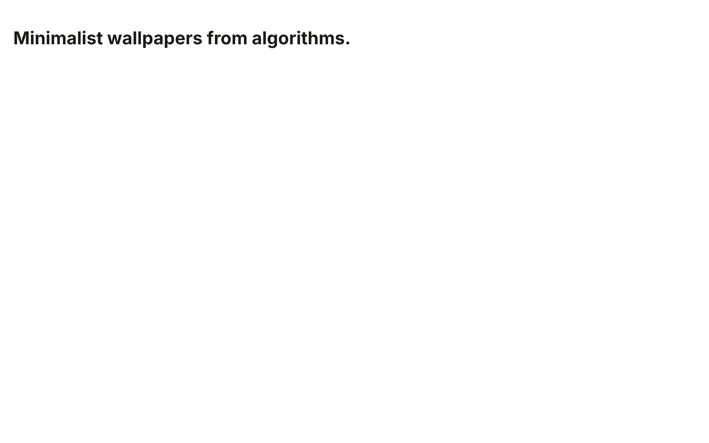
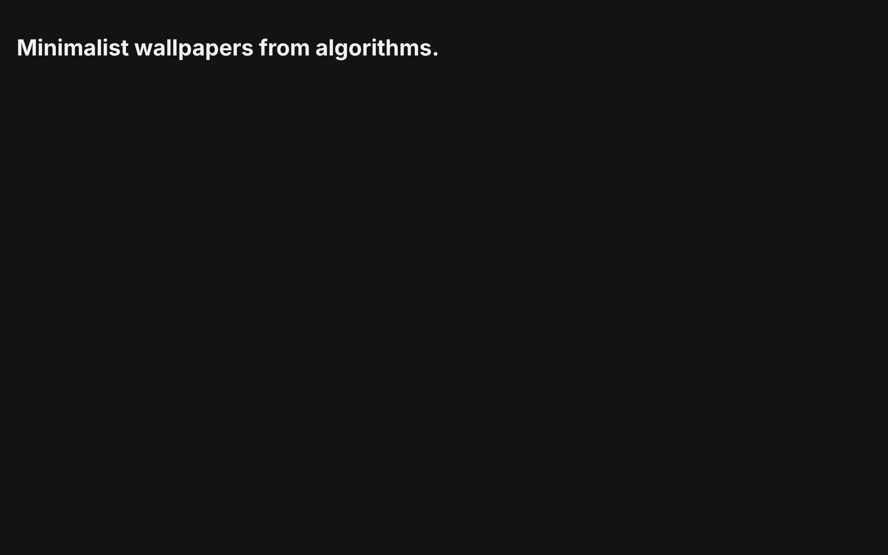
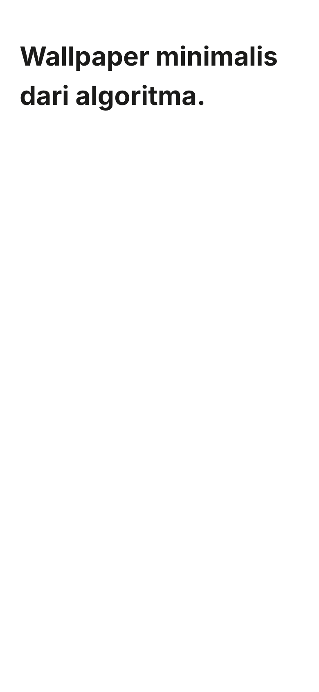
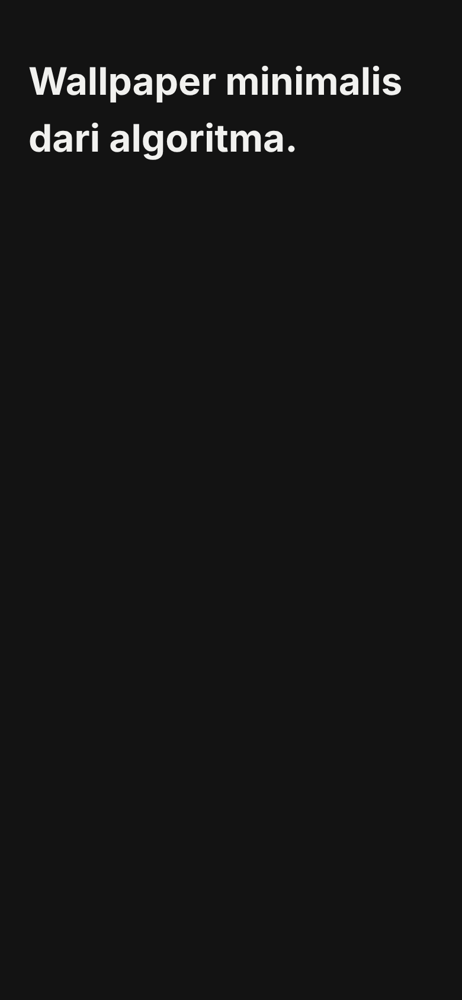
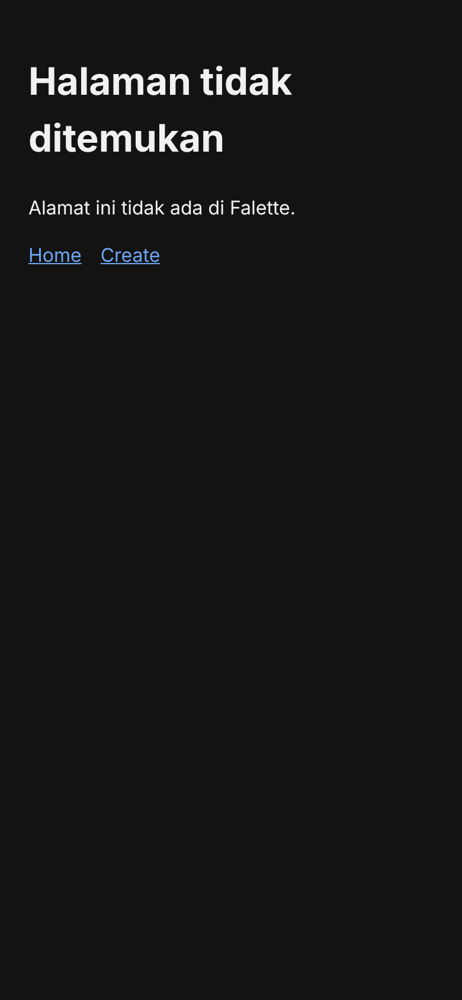

# Sesi 1: Rute, bahasa, dan tema — laporan

Sesi 1 dari [rencana Fase 1b](../rencana.md), sesuai [rencana sesi](rencana.md) yang disetujui FaL dengan perubahan P1–P6. Branch `claude/charming-albattani-ms0114`, dari main `b3b2744`, di PR #14.

**Status:** kode dan tes selesai, dan CI wajib hijau. Satu hal belum terbukti: perilaku 404 dan header `frame-ancestors` di link Preview Vercel (T1). Kebijakan jaringan environment ini memblokir `*.vercel.app`, jadi buktinya menunggu hasil `curl` dari FaL ([bagian T1](#link-preview-vercel-t1)).

---

## Yang berubah

| Commit | File | Isi | ID |
| --- | --- | --- | --- |
| `c2d83f3` | `rencana.md` | Catatan persetujuan dan perubahan P1–P6 | |
| `3ae9423` | `package.json`, `package-lock.json` | `@fontsource-variable/inter` 5.3.0 (OFL-1.1) di `dependencies`; `@axe-core/playwright` 4.14.0 di `devDependencies` | PRV-06, NFR Aksesibilitas |
| `22c7766` | `src/` dan `vite.config.ts` | Rute per bahasa, pengalih `/` dan `/create/`, token dan tema, kamus en dan id, halaman 404 | NAV-10, NAV-11, THM-01, THM-02, THM-04, THM-06 |
| `4484946` | `tests/` | 37 tes unit dan 52 tes Playwright baru | |
| `dbb3ac8` | `vercel.json` | Header `Content-Security-Policy: frame-ancestors 'none'` | NFR Keamanan |
| `590c2d6` | `.github/workflows/ci.yml` | CI untuk setiap PR | T5 |
| `9055632` | `AGENTS.md` | Baris peta folder untuk tempat baru | Jawaban 3, T5 |
| `56f7167` | `*.png` | Tangkapan layar | |
| Commit laporan | `laporan.md` | Laporan ini | |

Yang tidak disentuh: engine, pola, ekspor, link berbagi, preset, snapshot ENG-08, PRD, dan katalog. Versi engine tetap 1.

---

## Cara kerja

**Skrip inline.** Ada tiga skrip kecil di `src/lib/inline/`. `src/hooks.server.ts` menyisipkannya saat prerender, tepat setelah meta CSP dan sebelum link CSS (P2). `vite.config.ts` menghitung hash SHA-256 dari file yang sama dan memasukkannya ke `script-src`.

| Halaman | Skrip | Ukuran |
| --- | --- | --- |
| Semua | `theme.js` | 697 B |
| `/`, `/create/` | `lang-redirect.js`, lalu `theme.js` | 788 B + 697 B |
| `404.html` | `lang-404.js`, lalu `theme.js` | 861 B + 697 B |

**Bahasa.**

- Ketujuh halaman di-prerender: `/`, `/create/`, `/en/`, `/id/`, `/en/create/`, `/id/create/`, dan `/404.html`.
- `hooks.server.ts` mengisi `<html lang>` per halaman.
- Kamus dimuat lewat `import()` per bahasa, jadi browser hanya mengunduh bahasa aktif.
- `hreflang` mengikuti halamannya (P4), dan URL-nya dibentuk dari `SITE_URL` di `src/lib/site.ts`.
- Halaman pengalih tidak memuat JavaScript aplikasi (`csr = false`). Pengalihnya mempertahankan query dan hash (P3).
- Bahasa tersimpan dibaca dari `falette:lang`. Sesi ini hanya membacanya; yang menulis nanti dropdown bahasa di Sesi 2.

**Tema.**

- Token ada di `src/app.css`, dan `:root[data-theme='dark']` menimpa token warna.
- `theme.js` memasang `data-theme` dari `falette:theme`, atau dari setelan sistem. Pilihan tersimpan dibaca ulang setiap kali setelan sistem berubah (P6).
- Tanpa JavaScript, tema tetap terang.

**404.**

- `src/routes/404.html/` memakai `trailingSlash = 'never'` dan `csr = false`, jadi build menulis `404.html`.
- HTML-nya memuat teks kedua bahasa, dan CSS hanya menampilkan bahasa yang ada di `<html lang>`. `lang-404.js` mengganti `lang` dan judul sesuai bahasa tersimpan, dengan cadangan English.
- `paths: { relative: false }` membuat CSS dan tautan berbentuk `/_app/…` dan `/en/…`, sehingga tetap benar di path bertingkat (P1).

**Font.** Inter Variable sumbu `wght`. Untuk en dan id hanya subset latin yang diunduh: `inter-latin-wght-normal.woff2`, 48.256 B.

---

## Hasil uji

| Perintah | Hasil |
| --- | --- |
| `npm run check` | 0 error, 0 peringatan (425 file) |
| `npm run lint` | Bersih |
| `npm test` | 656 tes unit (37 baru) dan 101 tes Playwright di Chromium (52 baru) lulus. Snapshot ENG-08 tidak berubah. |
| `npm run build` | Berhasil, 7 halaman |

Tes baru:

| File | Jumlah | Isi |
| --- | --- | --- |
| `tests/i18n.test.ts` | 5 | Kunci dan placeholder en dan id sama, tidak ada teks kosong, `t()` mengisi placeholder |
| `tests/tokens.test.ts` | 21 | Tema gelap menimpa semua token warna; 10 pasangan kontras di kedua tema |
| `tests/inline-scripts.test.ts` | 11 | Ketiga skrip dijalankan di `node:vm`, termasuk penyimpanan yang melempar error, pilihan tema yang disimpan setelah halaman dimuat (P6), dan setiap bahasa di `src/params/lang.ts` |
| `tests/site.e2e.ts` | 36 | Pengalih, query dan hash (P3), `lang` dan `hreflang` (P4), urutan skrip (P2), tanpa atribut `style` (T2), tema tanpa kedip, navigasi antarbahasa, dan 404 di path bertingkat (P1) |
| `tests/budget.e2e.ts` | 2 | JS awal Home dan Create |
| `tests/a11y.e2e.ts` | 14 | axe WCAG 2.2 AA di semua halaman, terang dan gelap |

Semua tes e2e halaman situs gagal bila browser mencatat pelanggaran CSP (`tests/helpers/site.ts`).

**Pengukuran**

| Hal | Hasil |
| --- | --- |
| JS awal `/en/` | 37.717 B gzip (batas 100 KB) |
| JS awal `/en/create/` | 37.720 B gzip (batas 200 KB) |
| Font yang diunduh di en dan id | 48.256 B (woff2) |

**Uji mutasi P1:** dengan `paths.relative: true`, kedua tes 404 di path bertingkat gagal karena kedua bahasa tampil (2, bukan 1). Setelah dikembalikan ke `false`, keduanya lulus.

---

## CI

| Job | Run 1 (`9055632`) | Run 2 (`56f7167`) |
| --- | --- | --- |
| `verify` (check, lint, unit, build) | Lulus | Lulus |
| `e2e-chromium` | Lulus | Lulus |
| `e2e-firefox-webkit` (informasi) | Dibatalkan, karena run 2 menggantikannya | Gagal: 201 dari 202 tes lulus (8,6 menit) |

**Firefox dan WebKit (run 2).** Semua 52 tes baru Sesi 1 lulus di kedua browser. Satu-satunya yang gagal adalah tes Fase 1a, `[firefox] tests/export/png.e2e.ts:156` ("EXP-07: lets the page paint before the heavy work starts"). Tes itu mengharapkan penanda `painted` lebih kecil dari `started`, tetapi keduanya bernilai 155. Penyebabnya resolusi timer: Firefox membulatkan `performance.now()` (biasanya ke 1 ms), sehingga dua penanda dalam milidetik yang sama bernilai sama.

Tes itu tidak disentuh PR ini dan baru pertama kali berjalan di Firefox lewat CI. Aku tidak mengubahnya, karena melonggarkan tes supaya lulus dilarang AGENTS.md, dan job ini memang boleh gagal sampai Sesi 13. Usulan untuk Sesi 13: bandingkan urutan kejadian, bukan stempel waktunya, atau terima nilai yang sama bila resolusi timer browser lebih kasar dari jarak keduanya.

Workflow membatalkan run lama di branch yang sama, jadi setiap push memulai run baru. Job WebKit paling lama di `tests/export/timing.e2e.ts` (6,3 menit).

**Supaya job wajib benar-benar menahan merge,** FaL perlu memasang ruleset di GitHub:

1. Buka Settings → Rules → Rulesets → New ruleset → New branch ruleset.
2. Beri nama, mis. `main`, lalu set Enforcement status ke Active.
3. Di Target branches, tambahkan Include default branch.
4. Centang Require status checks to pass, lalu tambahkan `verify` dan `e2e-chromium`.
5. Simpan dengan Create. Jangan tambahkan `e2e-firefox-webkit`, karena job itu hanya informasi sampai Sesi 13.

---

## Link Preview Vercel (T1)

**Belum terbukti.** `curl` ke `https://falette-git-claude-charming-albattani-ms0114-fa-lt-ech.vercel.app` dan `https://falette.vercel.app` dari sesi ini ditolak proxy (403), karena kebijakan jaringan environment memblokir `*.vercel.app`. Deployment Vercel untuk kedua commit sudah berstatus Ready.

Bukti tidak langsung dari simulasi `VERCEL=1 npm run build`: `.vercel/output/config.json` yang ditulis adapter-static hanya berisi pengalihan garis miring, header cache untuk `/_app/immutable`, `handle: filesystem`, dan status 404 untuk aset `/_app/immutable` yang hilang. Tidak ada aturan yang menyajikan `404.html`. Jadi kemungkinan besar path asal-asalan masih menampilkan 404 bawaan Vercel.

Langkah berikutnya, setelah FaL mengirim hasil `curl`:

- Bila 404 bawaan Vercel tampil atau header `frame-ancestors` tidak terkirim, pembungkus adapter dipasang di PR ini (keputusan 2 di rencana sesi). Bukti `curl` sebelum dan sesudahnya dicatat di sini.
- Bila `vercel.json` terbukti diabaikan, hal itu bertentangan dengan NFR Keamanan, yang menyebut `vercel.json`. FaL memperbarui PRD secara terpisah.

---

## Tangkapan layar

Kerangka halaman dengan token dan font Inter. Home desktop terang dan gelap, 1280 × 800:

Home ponsel (Indonesia), terang dan gelap, 390 × 844:

`404.html` disajikan di `/id/tidak-ada/` dengan bahasa tersimpan `id`: CSS termuat dan hanya teks Indonesia yang tampil (P1):

---

## Penyimpangan dan catatan

1. **Tipe `Handle`** di SvelteKit 3 ada di `@sveltejs/kit/hooks`, bukan `@sveltejs/kit`.
2. **Tautan memakai `resolve()` dari `$app/paths`,** karena aturan ESLint `svelte/no-navigation-without-resolve`. Bentuk path seperti `` `${lang}/create/` `` dipakai supaya garis miring di akhir tetap ada.
3. **axe tidak bisa berjalan bila JavaScript dimatikan.** Karena itu halaman pengalih diuji dalam bentuk yang dilihat pengunjung tanpa JavaScript: skrip pengalih dibuang dan isi `<noscript>` ditampilkan, lewat `page.route`.
4. **`package-lock.json` dibuat ulang dengan npm 11.21.0,** karena npm 10.9.4 di container membuang bidang `libc` dari paket bawaan rolldown dan lightningcss. Selain dua paket baru (ditambah `axe-core`), npm hanya membuang satu entri `yaml` 2.9.1 yang berstatus `extraneous` dan tidak dipakai.
5. **`npm audit`** mencatat 6 temuan (4 low, 2 moderate) di alat pengembangan: deepmerge lewat `@sveltejs/vite-plugin-svelte`, dan vitest. Semuanya sudah ada sebelum sesi ini, dan kedua paket baru tidak menambah temuan.
6. **Skrip inline ikut membawa komentarnya** (tabel di atas). Hash dihitung dari teks yang sama, jadi komentar tidak merusak CSP.
7. **`hooks.server.ts` punya jalur cadangan:** halaman tanpa meta CSP mendapat skrip di awal `<head>`. Semua halaman prerender punya meta CSP, dan tes urutan skrip memastikannya.
8. **`t()` sudah mendukung `{placeholder}`** sesuai rencana, walaupun teks Sesi 1 belum memakainya. Teks ekspor di Sesi 10 akan memakainya, dan perilakunya sudah diuji.
9. **`<html lang>` mengikuti navigasi di browser** lewat `$effect` di layout bahasa. Di Sesi 1 belum ada tautan antarbahasa, jadi tes menyisipkan tautan sementara ke halaman. Dropdown di Sesi 2 akan memakai jalur yang sama.

---

## Belum diuji

- Perilaku Vercel yang sebenarnya: 404 di path asal-asalan, termasuk yang bertingkat, dan header `frame-ancestors` (T1).
- Safari dan Firefox di device asli. Di CI, Firefox dan WebKit lewat Playwright sudah berjalan, dengan satu kegagalan Fase 1a (bagian CI).
- Device asli: pengalih bahasa di ponsel, tema yang ikut berubah saat setelan sistem berubah, dan tidak adanya kedip saat dimuat ulang.
- Path tak dikenal di server lokal. `vite preview` dijalankan SvelteKit, jadi 404 hanya diuji dengan menyajikan `404.html` lewat `page.route`.
- Lighthouse, yang menunggu Sesi 13.
