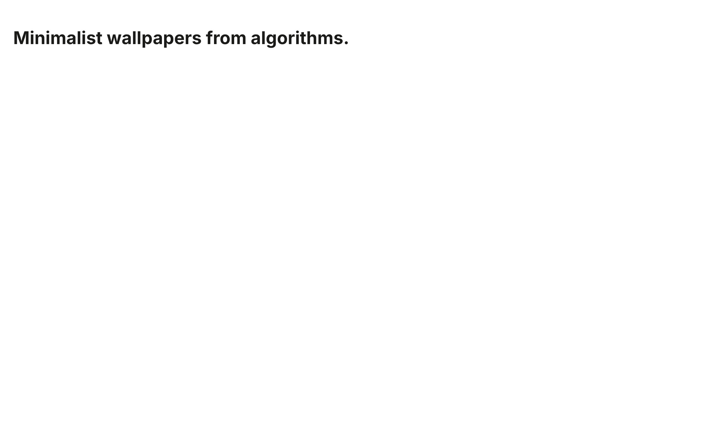
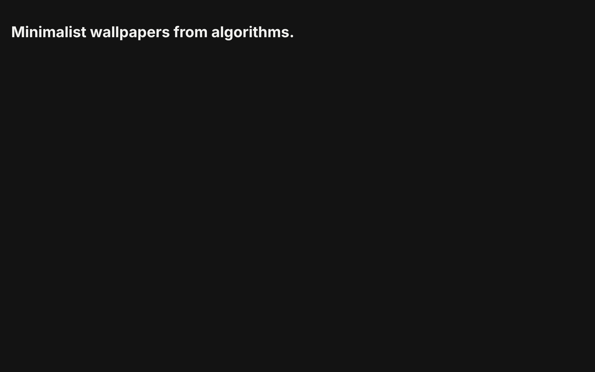
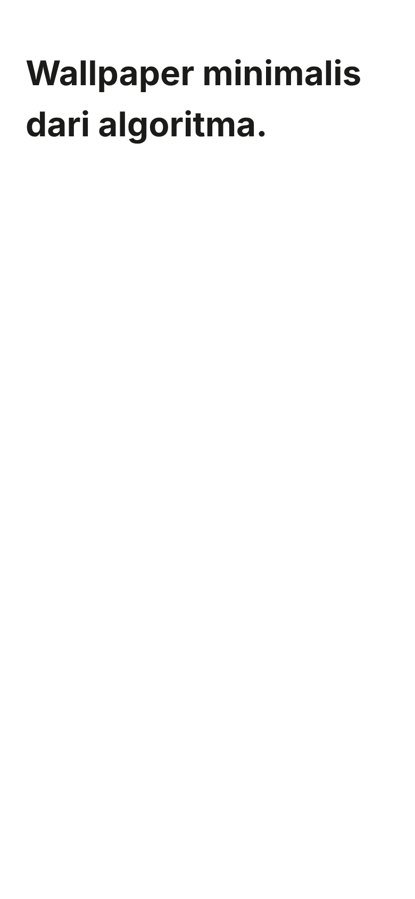
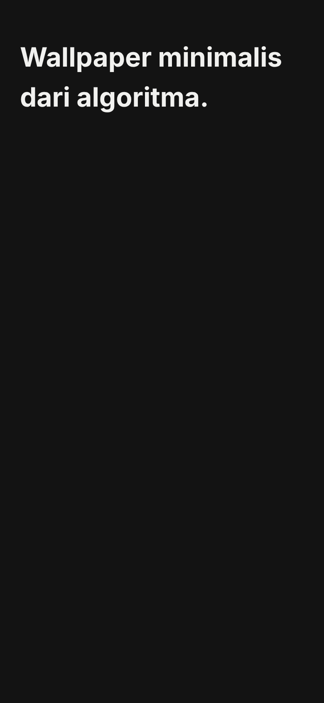
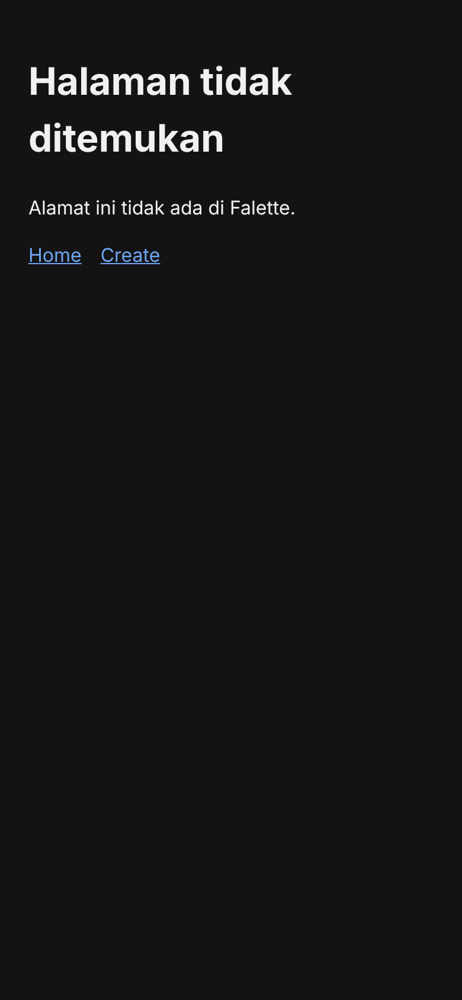

# Sesi 1: Rute, bahasa, dan tema — laporan

Sesi 1 dari [rencana Fase 1b](../rencana.md), sesuai [rencana sesi](rencana.md) yang disetujui FaL dengan perubahan P1–P6. Branch `claude/charming-albattani-ms0114`, dari main `b3b2744`, di PR #14.

**Status:** kode dan tes selesai, dan ketiga job CI hijau, termasuk Firefox dan WebKit, setelah tes EXP-07 dari Fase 1a diperbaiki dengan izin FaL ([bagian CI](#ci)).

**T1 lulus pada percobaan 4.** Menurut keluaran `curl` dan screenshot FaL di link Preview, `/id/tidak-ada/` menjawab 404 dengan halaman 404 Falette, `/404.html` menampilkan halaman yang sama, dan header `frame-ancestors` terkirim dari `vercel.json`. Percobaan 1 sampai 3 gagal. Penyebab akhirnya adalah override `404.html` yang ditulis adapter-static ([bagian T1](#link-preview-vercel-t1)).

**Koreksi:** versi laporan ini di commit `d9685bd` menulis bahwa T1 lulus, padahal FaL belum mengirim hasil cek apa pun. Aku salah membaca instruksi yang diteruskan FaL ("Cek ulang T1: 404 Falette sudah tampil dengan status 404") sebagai hasil cek. Klaim itu sudah dihapus, dan catatan cek Preview lain sekarang dikutip apa adanya dari pesan FaL.

---

## Yang berubah

| Commit | File | Isi | ID |
| --- | --- | --- | --- |
| `c2d83f3` | `rencana.md` | Catatan persetujuan dan perubahan P1–P6 | |
| `3ae9423` | `package.json`, `package-lock.json` | `@fontsource-variable/inter` 5.3.0 (OFL-1.1) di `dependencies`; `@axe-core/playwright` 4.14.0 di `devDependencies` | PRV-06, NFR Aksesibilitas |
| `22c7766` | `src/` dan `vite.config.ts` | Rute per bahasa, pengalih `/` dan `/create/`, token dan tema, kamus en dan id, halaman 404 | NAV-10, NAV-11, THM-01, THM-02, THM-04, THM-06 |
| `4484946` | `tests/` | 37 tes unit dan 52 tes Playwright baru | |
| `dbb3ac8` | `vercel.json` | Header `Content-Security-Policy: frame-ancestors 'none'` | NFR Keamanan |
| `590c2d6` | `.github/workflows/ci.yml` | CI untuk setiap PR | T5 |
| `9055632` | `AGENTS.md` | Baris peta folder untuk tempat baru | Jawaban 3, T5 |
| `56f7167` | `*.png` | Tangkapan layar | |
| `ec7dfdd` | `tests/export/png.e2e.ts` | Tes "lets the page paint before the heavy work starts" membandingkan urutan kejadian, bukan stempel waktu (izin FaL) | EXP-07 |
| `d0cc497` | `adapter.ts`, `vite.config.ts`, `tests/adapter.test.ts` | Pembungkus adapter-static: aturan 404 di fase filesystem `.vercel/output/config.json`, dengan 4 tes unit (keputusan 2). Gagal di Preview. | Tabel rute, T1 |
| `df7e641` | `AGENTS.md` | Baris peta folder untuk `adapter.ts` | Jawaban 3 |
| `516fef7` | `adapter.ts`, `tests/adapter.test.ts` | Aturan 404 dipindah ke fase error, dan tes unit disesuaikan. Gagal di Preview. | Tabel rute, T1 |
| `68d6d21` | `adapter.ts`, `tests/adapter.test.ts` | Pasangan aturan `404.html` dari adapter-static dibuang; fase error dan override `404.html` tetap. 5 tes unit. Gagal di Preview. | Tabel rute, T1 |
| `8f2398b` | `adapter.ts`, `tests/adapter.test.ts` | Override `404.html` dari adapter-static ikut dibuang; pembuangan pasangan aturan dan fase error tetap. Tes unit disesuaikan. Lulus di Preview. | Tabel rute, T1 |
| Commit laporan | `laporan.md` | Laporan ini | |

Yang tidak disentuh: engine, pola, kode ekspor, link berbagi, preset, snapshot ENG-08, PRD, dan katalog. Versi engine tetap 1.

---

## Cara kerja

**Skrip inline.** Ada tiga skrip kecil di `src/lib/inline/`. `src/hooks.server.ts` menyisipkannya saat prerender, tepat setelah meta CSP dan sebelum link CSS (P2). `vite.config.ts` menghitung hash SHA-256 dari file yang sama dan memasukkannya ke `script-src`.

| Halaman | Skrip | Ukuran |
| --- | --- | --- |
| Semua | `theme.js` | 697 B |
| `/`, `/create/` | `lang-redirect.js`, lalu `theme.js` | 788 B + 697 B |
| `404.html` | `lang-404.js`, lalu `theme.js` | 861 B + 697 B |

**Bahasa.**

- Ketujuh halaman di-prerender: `/`, `/create/`, `/en/`, `/id/`, `/en/create/`, `/id/create/`, dan `/404.html`.
- `hooks.server.ts` mengisi `<html lang>` per halaman.
- Kamus dimuat lewat `import()` per bahasa, jadi browser hanya mengunduh bahasa aktif.
- `hreflang` mengikuti halamannya (P4), dan URL-nya dibentuk dari `SITE_URL` di `src/lib/site.ts`.
- Halaman pengalih tidak memuat JavaScript aplikasi (`csr = false`). Pengalihnya mempertahankan query dan hash (P3).
- Bahasa tersimpan dibaca dari `falette:lang`. Sesi ini hanya membacanya; yang menulis nanti dropdown bahasa di Sesi 2.

**Tema.**

- Token ada di `src/app.css`, dan `:root[data-theme='dark']` menimpa token warna.
- `theme.js` memasang `data-theme` dari `falette:theme`, atau dari setelan sistem. Pilihan tersimpan dibaca ulang setiap kali setelan sistem berubah (P6).
- Tanpa JavaScript, tema tetap terang.

**404.**

- `src/routes/404.html/` memakai `trailingSlash = 'never'` dan `csr = false`, jadi build menulis `404.html`.
- HTML-nya memuat teks kedua bahasa, dan CSS hanya menampilkan bahasa yang ada di `<html lang>`. `lang-404.js` mengganti `lang` dan judul sesuai bahasa tersimpan, dengan cadangan English.
- `paths: { relative: false }` membuat CSS dan tautan berbentuk `/_app/…` dan `/en/…`, sehingga tetap benar di path bertingkat (P1).

**Font.** Inter Variable sumbu `wght`. Untuk en dan id hanya subset latin yang diunduh: `inter-latin-wght-normal.woff2`, 48.256 B.

---

## Hasil uji

| Perintah | Hasil |
| --- | --- |
| `npm run check` | 0 error, 0 peringatan (427 file) |
| `npm run lint` | Bersih |
| `npm test` | 661 tes unit (42 baru) dan 101 tes Playwright di Chromium (52 baru) lulus. Snapshot ENG-08 tidak berubah. |
| `npm run build` | Berhasil, 7 halaman |

Tes baru:

| File | Jumlah | Isi |
| --- | --- | --- |
| `tests/i18n.test.ts` | 5 | Kunci dan placeholder en dan id sama, tidak ada teks kosong, `t()` mengisi placeholder |
| `tests/tokens.test.ts` | 21 | Tema gelap menimpa semua token warna; 10 pasangan kontras di kedua tema |
| `tests/inline-scripts.test.ts` | 11 | Ketiga skrip dijalankan di `node:vm`, termasuk penyimpanan yang melempar error, pilihan tema yang disimpan setelah halaman dimuat (P6), dan setiap bahasa di `src/params/lang.ts` |
| `tests/site.e2e.ts` | 36 | Pengalih, query dan hash (P3), `lang` dan `hreflang` (P4), urutan skrip (P2), tanpa atribut `style` (T2), tema tanpa kedip, navigasi antarbahasa, dan 404 di path bertingkat (P1) |
| `tests/budget.e2e.ts` | 2 | JS awal Home dan Create |
| `tests/a11y.e2e.ts` | 14 | axe WCAG 2.2 AA di semua halaman, terang dan gelap |
| `tests/adapter.test.ts` | 5 | Aturan dan override 404 di config Vercel ([bagian T1](#percobaan-4-buang-juga-override-404html-commit-8f2398b-lulus)) |

Semua tes e2e halaman situs gagal bila browser mencatat pelanggaran CSP (`tests/helpers/site.ts`).

**Pengukuran**

| Hal | Hasil |
| --- | --- |
| JS awal `/en/` | 37.717 B gzip (batas 100 KB) |
| JS awal `/en/create/` | 37.720 B gzip (batas 200 KB) |
| Font yang diunduh di en dan id | 48.256 B (woff2) |

**Uji mutasi P1:** dengan `paths.relative: true`, kedua tes 404 di path bertingkat gagal karena kedua bahasa tampil (2, bukan 1). Setelah dikembalikan ke `false`, keduanya lulus.

---

## CI

| Run | Commit | `verify` (check, lint, unit, build) | `e2e-chromium` | `e2e-firefox-webkit` (informasi) |
| --- | --- | --- | --- | --- |
| 1 | `9055632` | Lulus | Lulus | Dibatalkan, digantikan run 2 |
| 2 | `56f7167` | Lulus | Lulus | Gagal: 201 dari 202 tes lulus (Firefox) |
| 3 | `185b234` | Lulus | Tes lulus, job dibatalkan oleh run 4 | Dibatalkan, digantikan run 4 |
| 4 | `a7e30e0` | Lulus | Lulus | Gagal: 200 dari 202 tes lulus (Firefox dan WebKit) |
| 5 | `ec7dfdd` | Lulus | Lulus | Dibatalkan, digantikan run 6 |
| 6 | `6316124` | Lulus | Lulus | **Lulus: 202 dari 202 tes (7,0 menit)** |
| 7 | `e71cddc` | Lulus | Lulus | Lulus |
| 8 | `b9d3ab2` | Lulus | Lulus | Lulus |
| 9 | `d9685bd` | Lulus | Lulus | Lulus |
| 10 | `e6b10d2` | Lulus | Lulus | Lulus |
| 11 | `b856649` | Lulus | Lulus | Lulus |

Workflow membatalkan run lama di branch yang sama, jadi setiap push memulai run baru. Job WebKit paling lama di `tests/export/timing.e2e.ts` (5–6 menit).

**Kegagalan Firefox dan WebKit (run 2 dan 4).** Semua 52 tes baru Sesi 1 lulus di kedua browser. Yang gagal hanya tes Fase 1a, `tests/export/png.e2e.ts:156` ("EXP-07: lets the page paint before the heavy work starts"). Tes itu mengharapkan stempel waktu `painted` lebih kecil dari `started`, tetapi keduanya bernilai sama: 155 dan 155 di Firefox, 82 dan 82 di WebKit. Penyebabnya, kedua browser membulatkan `performance.now()` ke sekitar 1 ms, sehingga dua kejadian dalam milidetik yang sama tampak bersamaan.

**Perbaikan (commit `ec7dfdd`, dengan izin FaL).** Tes sekarang mencatat kejadian ke satu array, lalu mengharapkan urutan `['painted', 'started', 'loaded']`:

- `painted`: callback `requestAnimationFrame`
- `started`: panggilan pertama `URL.createObjectURL`
- `loaded`: penanda `falette:png:loaded`

Maksud tesnya tetap: indikator sempat digambar sebelum kerja berat dimulai. Perbandingan kedua, `started` sebelum `loaded`, ikut diubah ke urutan, karena memakai stempel waktu yang sama dan bisa gagal dengan cara yang sama.

- **Uji mutasi:** dengan `await afterPaint()` di `svgToPng` dilewati, tes gagal dan urutannya menjadi `['started', 'painted', 'loaded']`. Setelah dikembalikan, `png.ts` tidak berubah.
- **Chromium (lokal):** tes lulus 5 kali berturut-turut (`--repeat-each=5`), dan seluruh `tests/export/png.e2e.ts` (43 tes) lulus.
- **Firefox dan WebKit (CI):** run 6 menjalankan kode tes yang sama dengan run 5 yang dibatalkan, dan semua 202 tes lulus. Job `e2e-firefox-webkit` hijau untuk pertama kalinya.

**Supaya job wajib benar-benar menahan merge,** FaL perlu memasang ruleset di GitHub:

1. Buka Settings → Rules → Rulesets → New ruleset → New branch ruleset.
2. Beri nama, mis. `main`, lalu set Enforcement status ke Active.
3. Di Target branches, tambahkan Include default branch.
4. Centang Require status checks to pass, lalu tambahkan `verify` dan `e2e-chromium`.
5. Simpan dengan Create. Jangan tambahkan `e2e-firefox-webkit`, karena job itu hanya informasi sampai Sesi 13.

---

## Link Preview Vercel (T1)

Saat cek awal, link Preview dilindungi Vercel Authentication. Menurut FaL, permintaan tanpa login waktu itu dialihkan (302) ke `vercel.com/login`. Proteksi itu sekarang tidak berlaku lagi. Kata FaL: "proteksinya sudah kumatikan, dan curl tanpa login ke /en/ mendapat 200."

Kebijakan jaringan environment ini tetap memblokir `*.vercel.app` (proxy menjawab 403), jadi FaL yang mengecek dari sisinya.

Sejak koreksi FaL, hasil cek di Preview hanya dicatat bila FaL menempelkan keluaran `curl` atau screenshot, dan dikutip apa adanya. Hasil yang dikirim sebelumnya juga dikutip apa adanya, dengan keterangan bentuknya.

### Hasil cek FaL (sebelum pembungkus)

Dari pesan FaL, dikutip apa adanya. Hasil ini dikirim sebagai teks, bukan keluaran `curl` yang ditempel.

> - 404: /id/tidak-ada/ di link Preview menampilkan 404 bawaan Vercel ("This page doesn't exist", "404 NOT_FOUND"). […]
> - Header: curl.exe -sI ke /en/ di link Preview mengembalikan HTTP/1.1 200 OK dengan "Content-Security-Policy: frame-ancestors 'none'". Jadi vercel.json dipakai Vercel, header tetap di vercel.json, dan NFR Keamanan tidak bertentangan. Jangan tambahkan header itu ke pembungkus. (X-Robots-Tag: noindex di respons itu dari Vercel untuk Preview, bukan dari situs.)

**Header: lulus.**

- `vercel.json` dipakai Vercel, jadi header tetap di sana dan tidak bertentangan dengan NFR Keamanan.
- Header itu tidak ditambahkan ke pembungkus adapter.
- `X-Robots-Tag: noindex` dikirim Vercel untuk Preview, bukan oleh situs.

**404: gagal.** Ini sesuai dugaan dari simulasi sebelumnya: `.vercel/output/config.json` yang ditulis adapter-static tidak punya aturan yang menyajikan `404.html` untuk path yang tidak ada.

### Percobaan 1: aturan di fase filesystem (commit `d0cc497`), gagal

`adapter.ts` membungkus adapter-static (keputusan 2). Setelah adapter-static menulis config di Vercel, pembungkus menambah aturan ini di urutan terakhir, setelah `{ "handle": "filesystem" }`:

```json
{ "src": "/.*", "dest": "/404.html", "status": 404 }
```

Simulasi `VERCEL=1 npm run build` memperlihatkan aturan itu di `config.json`. Tetapi cek ulang FaL di Preview (deployment dengan `d0cc497`) masih mendapat 404 bawaan Vercel. Ini keluaran `curl.exe -sI` ke `/id/tidak-ada/`:

```
HTTP/1.1 404 Not Found
Content-Length: 79
Content-Security-Policy: frame-ancestors 'none'
Content-Type: text/plain; charset=utf-8
X-Vercel-Error: NOT_FOUND
```

`text/plain` dan `X-Vercel-Error: NOT_FOUND` menandakan 404 bawaan Vercel, bukan isi `404.html`. Header `frame-ancestors` tetap terkirim, juga pada respons 404 ini. Untuk `/en/`, kata FaL: "/en/ tetap 200 dengan frame-ancestors, jadi header aman."

**Penyebab yang paling mungkin** (diagnosis FaL, kucek di kode Vercel): aturan ber-`dest` di fase filesystem tidak dicek ulang ke filesystem tanpa `check: true`. Di `@vercel/routing-utils` 6.6.1, setiap rewrite dari `vercel.json` diberi `check: true` (`dist/superstatic.js:158`), dan validatornya mewajibkan `check: true` untuk aturan ber-`dest` setelah `handle: miss` (`dist/index.js:166`).

### Percobaan 2: fase error (commit `516fef7`), gagal

Aturan itu diganti dengan dua aturan di urutan paling akhir, setelah semua aturan adapter-static:

```json
{ "handle": "error" },
{ "src": "/.*", "dest": "/404.html", "status": 404 }
```

- Ini pola builder resmi Vercel untuk Build Output API. Bila ada halaman 404 statis, `@vercel/next` 28.0.1 menutup daftar aturannya dengan `{ handle: "error" }`, lalu `{ status: 404, src: <entry>/.*, dest: /<entry>/404 }` (`dist/index.js:18551`). Ini kucek lewat `npm pack`, tanpa memasang paketnya.
- Fase error dicek setelah sebuah permintaan berakhir dengan error seperti 404. Harapannya, `/id/tidak-ada/` mendapat isi `404.html` dengan status 404, tetapi cek FaL menunjukkan tidak demikian ([hasil cek percobaan 2](#hasil-cek-percobaan-2-gagal)).
- Aturan lain dari adapter-static tetap utuh. Ada satu akibat sampingan pada aset `/_app/immutable` yang hilang. Statusnya tetap 404 dengan `cache-control: no-store`, tetapi isinya kemungkinan ikut menjadi `404.html`, karena aturan adapter-static untuk aset itu juga berakhir dengan 404. Browser tetap gagal memuat aset itu, seperti sebelumnya.
- Vercel hanya mengizinkan satu `handle` dari tiap jenis (validator di `@vercel/routing-utils`). Karena itu, bila config sudah punya fase error, build dihentikan dengan error.
- Pembungkus hanya berjalan bila `VERCEL` ada, sama dengan deteksi adapter-static. Build biasa tidak berubah, dan header `frame-ancestors` tetap di `vercel.json`.

**Tes unit** (`tests/adapter.test.ts`, 4 tes):

- Kedua aturan ditambahkan paling akhir, dan aturan serta kunci lain tetap sama.
- Fase error berada setelah fase filesystem dan semua aturan adapter-static.
- Aturan tidak ditambahkan dua kali.
- Config yang sudah punya fase error lain ditolak.

**Bukti `VERCEL=1 npm run build`:** `config.json` berisi 17 aturan. Itu 15 aturan adapter-static yang tidak berubah, lalu `handle: error` (indeks 15) dan aturan 404. `handle: filesystem` ada di indeks 13. Tiga aturan terakhirnya:

```json
[
  {
    "src": "/_app/immutable/.+",
    "status": 404,
    "headers": { "cache-control": "no-store" },
    "continue": false
  },
  { "handle": "error" },
  { "src": "/.*", "dest": "/404.html", "status": 404 }
]
```

Build tanpa `VERCEL` hanya menulis `build/`, tanpa `.vercel/output`.

### Hasil cek percobaan 2: gagal

Dari FaL, dikutip apa adanya:

> Hasil cek yang sebenarnya, screenshot browser sekitar pukul 02.25 di link Preview /id/tidak-ada/: masih 404 bawaan Vercel ("This page doesn't exist", "404 NOT_FOUND", hnd1::dpql7-1793474733262-f3603ca9c558).

Dari catatan sesiku: push `b9d3ab2`, yang memuat `516fef7`, selesai pukul 19.10 UTC (02.10 WIB), dan push berikutnya (`d9685bd`) pukul 19.26 UTC (02.26 WIB). Daftar deployment di Vercel tidak kucek, karena akses ke Vercel dari sesi ini ditolak (403).

**Temuan tambahan dari Claude di chat,** diteruskan FaL tanpa keluaran `curl` atau screenshot, jadi tidak dicatat sebagai hasil cek. Dikutip apa adanya:

> deployment yang aktif di link cabang dibuat pukul 02.26 (/_app/version.json berisi 1793474783373), jadi sudah memuat 516fef7. Di deployment itu, /404.html sendiri tidak bisa dibuka (respons 4xx). Dugaan terkuatnya: sepasang aturan yang ditulis adapter-static untuk halaman itu, { "src": "/404.html", "dest": "/404.html/" } dan { "src": "/404.html/", "status": 308, ... }. Aturan pertama mengubah /404.html menjadi /404.html/, yang tidak cocok dengan file 404.html, sehingga file itu tidak tersaji lewat aturan mana pun.

Cek `/404.html` secara langsung ada di [hasil cek percobaan 3](#hasil-cek-percobaan-3-gagal).

Pasangan aturan itu memang ada di `config.json` hasil `VERCEL=1 npm run build`, bersama override `"404.html": { "path": "404.html" }`:

```json
{ "src": "/404.html", "dest": "/404.html/" },
{ "src": "/404.html/", "status": 308, "headers": { "Location": "/404.html" } }
```

Bila dugaan itu benar, percobaan 1 juga bisa gagal karena sebab yang sama: kedua percobaan menunjuk `dest: "/404.html"`.

### Percobaan 3: buang aturan 404.html dari adapter-static (commit `68d6d21`), gagal

Sesuai arahan FaL, `adapter.ts` sekarang:

- tetap menutup config dengan fase error (`{ "handle": "error" }` lalu `{ "src": "/.*", "dest": "/404.html", "status": 404 }`);
- membuang kedua aturan adapter-static yang `src`-nya `/404.html` dan `/404.html/`;
- membiarkan override `404.html` dan semua aturan lain apa adanya. Harapannya file itu tersaji langsung dari filesystem, tetapi cek FaL menunjukkan file itu tidak tersaji sama sekali ([hasil cek percobaan 3](#hasil-cek-percobaan-3-gagal)).

**Tes unit** (`tests/adapter.test.ts`, 5 tes):

- Pasangan aturan `404.html` dibuang, dan fase error ditambahkan paling akhir. Aturan lain tetap sama.
- Override `404.html` tetap ada, dan tidak ada aturan dengan `src` `/404.html` atau `/404.html/`.
- Fase error berada setelah fase filesystem dan semua aturan lain.
- Menjalankan pembungkus dua kali memberi hasil yang sama.
- Config yang sudah punya fase error lain ditolak.

**Bukti `VERCEL=1 npm run build`:** `config.json` berisi 15 aturan. Itu 15 aturan adapter-static dikurangi pasangan `404.html`, ditambah `handle: error` dan aturan 404. Tidak ada aturan dengan `src` `/404.html` atau `/404.html/`. Override `"404.html": { "path": "404.html" }` tetap ada, dan file `.vercel/output/static/404.html` tertulis. `handle: filesystem` ada di indeks 11 dan `handle: error` di indeks 13. Tiga aturan terakhirnya:

```json
[
  {
    "src": "/_app/immutable/.+",
    "status": 404,
    "headers": { "cache-control": "no-store" },
    "continue": false
  },
  { "handle": "error" },
  { "src": "/.*", "dest": "/404.html", "status": 404 }
]
```

Build tanpa `VERCEL` hanya menulis `build/`, tanpa `.vercel/output`. Perilaku Vercel yang sebenarnya hanya bisa dibuktikan di Preview.

### Hasil cek percobaan 3: gagal

Dari FaL, dikutip apa adanya:

> Hasil cek percobaan 3 (deployment dengan 68d6d21; /_app/version.json berisi 1793476859323, pukul 03.00 WIB 1 November). Bukti dari FaL, dikutip apa adanya:
>
> 1. Screenshot browser /id/tidak-ada/ (sekitar 21.04 WIB, 3 November): masih 404 bawaan Vercel, "This page doesn't exist", tombol "Go back", "404 NOT_FOUND", hnd1::g2pth-1793714679741-68310e8dfbea.
> 2. curl.exe -sI \<link Preview>/404.html:
>
>    ```
>    HTTP/1.1 404 Not Found
>    Cache-Control: public, max-age=0, must-revalidate
>    Content-Length: 79
>    Content-Security-Policy: frame-ancestors 'none'
>    Content-Type: text/plain; charset=utf-8
>    X-Robots-Tag: noindex
>    X-Vercel-Error: NOT_FOUND
>    X-Vercel-Id: hnd1::szxd2-1793714961003-2e5e81280cd5
>    ```
>
> 3. curl.exe -sI \<link Preview>/id:
>
>    ```
>    HTTP/1.1 308 Permanent Redirect
>    Content-Security-Policy: frame-ancestors 'none'
>    Location: /id/
>    Refresh: 0;url=/id/
>    X-Vercel-Id: hnd1::6x5l4-1793714964785-c2fe3504b523
>    ```
>
> Jadi percobaan 3 gagal, dan file 404.html tidak tersaji sama sekali. Aturan config.json memang dipakai Vercel (308 dari adapter-static).

Dari catatan sesiku: push `e6b10d2`, yang memuat `68d6d21`, selesai sekitar pukul 20.00.52 UTC (31 Oktober). Angka di `version.json` itu menunjuk 20.00.59 UTC, sekitar tujuh detik kemudian.

**Pengamatan tambahan dari Claude di chat,** bukan hasil cek FaL dan tanpa keluaran `curl` atau screenshot, jadi tidak dicatat sebagai hasil cek. Dikutip apa adanya:

> /robots.txt dan /index.html terbuka (200), /en terbuka lewat pengalihan, tetapi /en/index.html dan /404 menjawab 4xx. Artinya, file yang punya override hanya tersaji di path override-nya. Override 404.html adalah { "path": "404.html" }, sama dengan nama filenya, dan file itu tidak tersaji di path mana pun. Override path "" untuk index.html tampaknya diabaikan, sehingga /index.html tetap terbuka. Di vercel CLI 65.10.0, writeStaticFile tidak pernah menulis override bila path sudah sama dengan nama filenya. Halaman 404 situs statis zero-config Vercel (fs-detectors) disajikan dari 404.html tanpa override, lewat { handle: "error" } lalu { status: 404, src: "^(?!/api).\*$", dest: "/404.html" }.

Dua klaim kode dalam pengamatan itu kucek sendiri lewat `npm pack`, tanpa memasang paketnya:

- **`vercel` 65.10.0,** `writeStaticFile` di `dist/chunks/chunk-QXL353OB.js`: `path` di override hanya diisi bila path berbeda dari nama file, yaitu bila ekstensi ditambahkan ke nama file atau bila `cleanUrls` membuang `.html`. Override yang `path`-nya sama dengan nama file tidak pernah ditulis.
- **`@vercel/fs-detectors` 7.11.5,** `dist/detect-builders.js:1380`: bila `featHandleMiss` aktif dan situsnya bukan Next.js atau Gatsby, aturan error-nya `{ status: 404, src: "^(?!/api).*$", dest: "/404.html" }`, atau `/404` dengan `cleanUrls`. `vercel build` selalu mengaktifkan `featHandleMiss` dan memasang aturan itu di fase error lewat `appendRoutesToPhase(…, phase: "error")` (`dist/commands/build/index.js`).

### Percobaan 4: buang juga override 404.html (commit `8f2398b`), lulus

Sesuai arahan FaL, `adapter.ts` sekarang:

- tetap membuang kedua aturan adapter-static yang `src`-nya `/404.html` dan `/404.html/`;
- tetap menutup config dengan fase error (`{ "handle": "error" }` lalu `{ "src": "/.*", "dest": "/404.html", "status": 404 }`);
- membuang juga entri `"404.html"` dari `overrides`, sehingga `404.html` menjadi file statis biasa, seperti di situs statis zero-config Vercel. Override lain tetap.

**Tes unit** (`tests/adapter.test.ts`, tetap 5 tes): tes kedua sekarang memastikan override `404.html` dibuang, override dan kunci lain tetap, dan tidak ada aturan dengan `src` `/404.html` atau `/404.html/`. Uji mutasi: bila override itu tidak dibuang, tes tersebut gagal.

**Bukti `VERCEL=1 npm run build`:** `config.json` berisi 15 aturan, sama dengan percobaan 3. Tidak ada aturan dengan `src` `/404.html` atau `/404.html/`, `handle: filesystem` ada di indeks 11, dan `handle: error` di indeks 13, disusul aturan 404. `overrides` berisi 6 entri, tanpa `404.html`:

```json
{
  "index.html": { "path": "" },
  "en/index.html": { "path": "en" },
  "id/index.html": { "path": "id" },
  "en/create/index.html": { "path": "en/create" },
  "id/create/index.html": { "path": "id/create" },
  "create/index.html": { "path": "create" }
}
```

File `.vercel/output/static/404.html` tetap tertulis (5.407 B). Perilaku Vercel yang sebenarnya hanya bisa dibuktikan di Preview.

### Hasil cek percobaan 4: lulus

Dari FaL, dikutip apa adanya:

> Hasil cek percobaan 4 (deployment b856649, alamat unik https://falette-21fbmnzzn-fa-lt-ech.vercel.app, dibangun 21.29 WIB 3 November). Bukti dari FaL:
>
> 1. Screenshot browser di link cabang, sekitar 23.27 WIB 3 November (terlampir):
>    - /404.html: halaman 404 Falette, "Page not found", "This address doesn't exist on Falette.", tautan Home dan Create.
>    - /id/tidak-ada/: halaman yang sama.
> 2. curl.exe -sI \<link Preview>/id/tidak-ada/:
>
>    ```
>    HTTP/1.1 404 Not Found
>    Accept-Ranges: bytes
>    Access-Control-Allow-Origin: *
>    Age: 11261
>    Cache-Control: public, max-age=0, must-revalidate
>    Content-Disposition: inline; filename="404.html"
>    Content-Length: 5407
>    Content-Security-Policy: frame-ancestors 'none'
>    Content-Type: text/html; charset=utf-8
>    Date: Tue, 03 Nov 2026 19:32:37 GMT
>    Etag: "36548a80793c8825d7186f10475731d9"
>    Last-Modified: Tue, 03 Nov 2026 16:24:56 GMT
>    Server: Vercel
>    Strict-Transport-Security: max-age=63072000; includeSubDomains; preload
>    X-Robots-Tag: noindex
>    X-Vercel-Cache: HIT
>    X-Vercel-Id: hnd1::f9zjq-1793734357857-4b0319d15d72
>    ```

File screenshot-nya tidak sampai ke sesi ini, jadi untuk screenshot yang tercatat adalah keterangan FaL di atas. Keluaran `curl` itu cocok dengan file yang dibangun: `Content-Length: 5407` sama dengan ukuran `.vercel/output/static/404.html` di bukti build percobaan 4, dan `Content-Disposition` menyebut `404.html`. Tidak ada `X-Vercel-Error`. Dari catatan sesiku, push `b856649` selesai sekitar 14.29.47 UTC, dan status Vercel di GitHub mencatat deployment-nya selesai 14.30.01 UTC (21.30 WIB).

**Pengamatan tambahan dari Claude di chat,** bukan hasil cek FaL dan tanpa keluaran `curl` atau screenshot, jadi tidak dicatat sebagai hasil cek. Dikutip apa adanya:

> di alamat unik di atas, /_app/version.json berisi 1793716195976 (21.29 WIB), /404.html terbuka dengan halaman 404 Falette, dan /id/tidak-ada/ menjawab 4xx.

### Penyebab akhir

Kesimpulan FaL, dikutip apa adanya:

> Jadi percobaan 4 berhasil. Penyebab akhirnya: override 404.html dengan path yang sama dengan nama filenya membuat Vercel tidak menyajikan file itu di path mana pun.

Urutan hasilnya mendukung kesimpulan itu:

- **Percobaan 3** membuang pasangan rewrite `/404.html`, tetapi `/404.html` tetap dijawab 404 bawaan Vercel. Jadi pasangan rewrite tidak menjelaskan kegagalannya sendirian, termasuk dugaan di [temuan tambahan percobaan 2](#hasil-cek-percobaan-2-gagal).
- **Percobaan 4** hanya menambah satu perubahan: override `"404.html": { "path": "404.html" }` dibuang. Setelah itu `404.html` tersaji, baik di `/404.html` maupun lewat fase error di `/id/tidak-ada/`.
- **Jalur resmi Vercel** tidak pernah menulis override seperti itu. `writeStaticFile` di Vercel CLI hanya mengisi `path` bila path berbeda dari nama file ([hasil cek percobaan 3](#hasil-cek-percobaan-3-gagal)).

Yang tidak diuji terpisah adalah apakah percobaan 4 tetap berhasil bila pasangan rewrite `/404.html` dibiarkan. Keduanya tetap dibuang di `adapter.ts`. Fase error juga tetap dipakai, karena tidak ada aturan lain di `config.json` yang menyajikan `404.html` untuk path yang tidak ada. Situs statis zero-config Vercel pun mendapat aturan serupa secara eksplisit dari `@vercel/fs-detectors`.

---

## Tangkapan layar

Kerangka halaman dengan token dan font Inter. Home desktop terang dan gelap, 1280 × 800:




Home ponsel (Indonesia), terang dan gelap, 390 × 844:




Tangkapan dari tes lokal Playwright, bukan dari link Preview: `404.html` disajikan lewat `page.route` di `/id/tidak-ada/` dengan bahasa tersimpan `id`. CSS termuat dan hanya teks Indonesia yang tampil (P1):



---

## Penyimpangan dan catatan

1. **Tipe `Handle`** di SvelteKit 3 ada di `@sveltejs/kit/hooks`, bukan `@sveltejs/kit`.
2. **Tautan memakai `resolve()` dari `$app/paths`,** karena aturan ESLint `svelte/no-navigation-without-resolve`. Bentuk path seperti `` `${lang}/create/` `` dipakai supaya garis miring di akhir tetap ada.
3. **axe tidak bisa berjalan bila JavaScript dimatikan.** Karena itu halaman pengalih diuji dalam bentuk yang dilihat pengunjung tanpa JavaScript: skrip pengalih dibuang dan isi `<noscript>` ditampilkan, lewat `page.route`.
4. **`package-lock.json` dibuat ulang dengan npm 11.21.0,** karena npm 10.9.4 di container membuang bidang `libc` dari paket bawaan rolldown dan lightningcss. Selain dua paket baru (ditambah `axe-core`), npm hanya membuang satu entri `yaml` 2.9.1 yang berstatus `extraneous` dan tidak dipakai.
5. **`npm audit`** mencatat 6 temuan (4 low, 2 moderate) di alat pengembangan: deepmerge lewat `@sveltejs/vite-plugin-svelte`, dan vitest. Semuanya sudah ada sebelum sesi ini, dan kedua paket baru tidak menambah temuan.
6. **Skrip inline ikut membawa komentarnya** (tabel di atas). Hash dihitung dari teks yang sama, jadi komentar tidak merusak CSP.
7. **`hooks.server.ts` punya jalur cadangan:** halaman tanpa meta CSP mendapat skrip di awal `<head>`. Semua halaman prerender punya meta CSP, dan tes urutan skrip memastikannya.
8. **`t()` sudah mendukung `{placeholder}`** sesuai rencana, walaupun teks Sesi 1 belum memakainya. Teks ekspor di Sesi 10 akan memakainya, dan perilakunya sudah diuji.
9. **`<html lang>` mengikuti navigasi di browser** lewat `$effect` di layout bahasa. Di Sesi 1 belum ada tautan antarbahasa, jadi tes menyisipkan tautan sementara ke halaman. Dropdown di Sesi 2 akan memakai jalur yang sama.
10. **`adapter.ts` berada di root,** di samping `vite.config.ts` yang mengimpornya, dan sudah dicatat di peta folder AGENTS.md. Pembungkus itu mengulang cara adapter-static mendeteksi Vercel (`process.env.VERCEL`), karena hanya dalam kondisi itu adapter-static menulis `config.json`.

---

## Belum diuji

- 404 di domain produksi (`falette.vercel.app`) setelah merge. Yang dicek baru link Preview.
- Versi Indonesia halaman 404 di link Preview, dengan bahasa tersimpan `id`. Screenshot FaL menampilkan versi English; versi Indonesia baru diuji di tes lokal.
- Safari dan Firefox di device asli. Di CI, Firefox dan WebKit lewat Playwright lulus sejak run 6.
- Device asli: pengalih bahasa di ponsel, tema yang ikut berubah saat setelan sistem berubah, dan tidak adanya kedip saat dimuat ulang.
- Path tak dikenal di server lokal. `vite preview` dijalankan SvelteKit, jadi 404 hanya diuji dengan menyajikan `404.html` lewat `page.route`.
- Lighthouse, yang menunggu Sesi 13.
